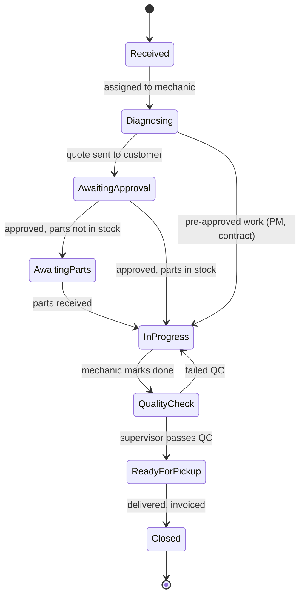
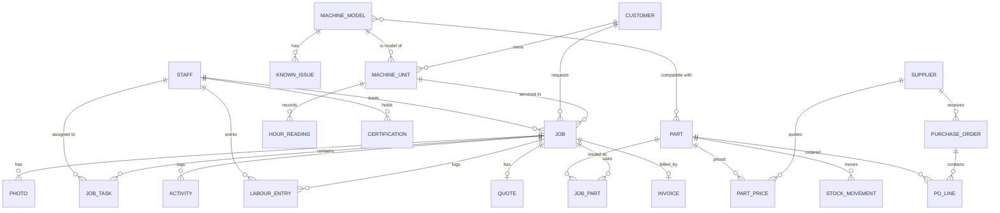

# HeavyDuty Garage — Workshop Management System Design

Software for running a heavy machinery service and repair workshop: emergency breakdown response, troubleshooting and diagnostics, preventive maintenance, hydraulic services, fabrication and painting.

A clickable prototype of the main screens lives in [`prototype/index.html`](../prototype/index.html).

---

## 1. Goals

1. **One screen to see the whole workshop.** Every job, its status, who is on it and what it is waiting for.
2. **A linear chain of command.** Boss → Supervisor → Mechanics → support crew. Work flows down, reports flow up, and nothing moves without an owner.
3. **Every machine has a memory.** Each unit keeps its full service history, photos, hour-meter readings and parts used, so a machine that has been with us for months (or comes back years later) can be looked up in seconds.
4. **Parts are found by machine model.** Pick "CAT 320D2" and see the filters, seal kits and wear parts that fit, what they cost us, what we sell them for and how many are on the shelf.
5. **Plan the work against due dates.** A calendar of target completion dates, PM services coming due and staff availability.
6. **Usable from the workshop floor.** Mechanics update jobs and take photos from a phone. The supervisor and boss use a desktop or tablet.

---

## 2. Roles and permissions

The structure stays linear: each person reports to exactly one level up.

```
Boss (Owner / Manager)
 └── Supervisor  (operations + parts & inventory)
      ├── Mechanics (lead technicians on jobs)
      │    └── Assistant Mechanics
      ├── Fabricators / Welders
      ├── Painters
      └── Cleaners
```

| Capability | Boss | Supervisor | Mechanic | Asst. Mechanic | Fabricator / Painter | Cleaner |
|---|:-:|:-:|:-:|:-:|:-:|:-:|
| See dashboard of all jobs | ✓ | ✓ | Own jobs | Own jobs | Own jobs | Own tasks |
| Create job / emergency call-out | ✓ | ✓ | Request only | – | – | – |
| Assign / reassign staff | ✓ | ✓ | – | – | – | – |
| Update job status, tasks, notes | ✓ | ✓ | ✓ (own) | Tasks only | ✓ (own) | Tasks only |
| Upload photos | ✓ | ✓ | ✓ | ✓ | ✓ | ✓ |
| Log labour time | ✓ | ✓ | ✓ | ✓ | ✓ | ✓ |
| Request parts for a job | ✓ | ✓ | ✓ | ✓ | ✓ | – |
| Issue parts from stock | ✓ | ✓ | – | – | – | – |
| See **selling** price of parts, job value | ✓ | ✓ | – | – | – | – |
| See **purchase** price of parts, supplier terms | ✓ | ✓ | – | – | – | – |
| See labour cost, pay rates, margins and job profit | ✓ | – | – | – | – | – |
| Create purchase orders | ✓ | ✓ (limit, e.g. RM 5,000) | – | – | – | – |
| Approve POs above limit, quotes, discounts | ✓ | – | – | – | – | – |
| Quality check & close job | ✓ | ✓ | – | – | – | – |
| Invoicing and financial reports | ✓ | View | – | – | – | – |
| Staff profiles | ✓ | View (no pay rates) | Own profile | Own profile | Own profile | Own profile |

**Cost visibility rule:** the Boss sees every cost. The Supervisor sees part purchase prices only (needed to buy stock and raise POs), never labour cost, pay rates or margins. Mechanics and crew see no prices at all, neither cost nor selling price.

Everyone logs in with their own account, which gives a clean audit trail ("who changed this job to Completed, and when").

---

## 3. Job categories

Each job gets one **category** (what kind of work), a **priority** and a **service location**.

| Code | Category | Typical work | Default priority |
|---|---|---|---|
| EMG | Emergency Breakdown | Machine down at site, call-out, 24/7 | Critical |
| DIAG | Troubleshooting & Diagnostics | Fault codes, intermittent faults, electrical, performance loss | High |
| PM | Preventive Maintenance | 250 / 500 / 1000 / 2000 hr services, inspections | Normal |
| MINOR | Minor Repair | Hoses, brakes, lights, small leaks, adjustments | Normal |
| MAJOR | Major Repair / Overhaul | Engine, transmission, final drive, swing motor rebuilds | Normal |
| HYD | Hydraulic Service | Pump/valve/cylinder reseal, hose making, pressure testing | High |
| FAB | Fabrication & Welding | Bucket rebuild, hardfacing, crack repair, custom brackets | Normal |
| PAINT | Painting & Refurbishment | Surface prep, full repaint, decals, cosmetic restoration | Low |
| WARR | Warranty / Comeback | Repeat of a recent repair, tracked against the original job | High |

**Service location:** Workshop (bay number) or Field (customer site with address, GPS pin and travel time).

**Priority:** Critical (machine down, respond now), High (within 24 h), Normal (scheduled), Low (fill-in work).

A job can carry **secondary tags** when it spans several trades, for example a refurbishment that is MAJOR + FAB + PAINT. Each trade gets its own task lines and assigned person inside the job.

---

## 4. Job lifecycle



| Status | Who moves it | What it means on the dashboard |
|---|---|---|
| Received | Supervisor | Machine/call logged, nobody working on it yet. Flags red if Critical and unassigned. |
| Diagnosing | Mechanic | Inspection and fault finding under way. |
| Awaiting Approval | Supervisor | Quote sent, waiting on customer. Shows days waiting. |
| Awaiting Parts | Supervisor | Linked to purchase order(s), shows ETA. |
| In Progress | Mechanic | Repair under way. |
| Quality Check | Supervisor | Test run, pressure readings, leak check, sign-off photos. |
| Ready for Pickup | Supervisor | Customer notified. Storage-day counter starts. |
| Closed | Boss / Supervisor | Delivered and invoiced. Becomes part of the machine's service history. |

**On Hold** can be applied on top of any status, with a reason (customer request, payment, waiting for specialist).

---

## 5. Modules

### 5.1 Dashboard

The home screen, laid out so a glance answers "what needs me right now?".

- **Status strip:** open jobs, active emergencies, overdue jobs, jobs due this week, staff on duty, low-stock items.
- **Job board:** kanban columns by status. Each card shows job number, category colour, priority stripe, machine, customer, lead mechanic and due date (red when overdue). Click a card to open the full job.
- **Active crew panel:** every staff member with their state today (On job / In field / Available / On leave) and the job they are on.
- **Attention list:** unassigned emergencies, quotes waiting more than 3 days, parts overdue from supplier, jobs past due date, machines in the yard longer than 30 days.
- **Boss-only tiles:** work-in-progress value, this month's invoiced revenue, labour utilisation.

### 5.2 Jobs (job card)

Opening a job shows everything about it on one page:

| Section | Contents |
|---|---|
| Header | Job no. (e.g. `J-2026-0418`), category, priority, status, service location, opened / due dates, days open |
| Machine | Model, serial no., hour meter at intake, owner, link to the machine's history |
| Customer complaint | What the customer reported, in their words, plus who called and contact number |
| Diagnosis | Mechanic's findings, fault codes, test readings (pressures, temperatures) |
| Tasks / checklist | Ordered task lines, each with assignee and done tick. PM jobs load a checklist template for the service interval |
| Team | Lead mechanic plus assistants, fabricator, painter, cleaner |
| Labour | Time entries per person (clock on / off a job from the phone) |
| Parts used | Parts issued from stock or ordered for this job, with quantity, selling price (and cost for supervisor/boss) |
| Photos | Before / during / after photos, tagged and captioned, taken from phone camera. Also videos (engine noise, leaks) |
| Documents | Quote, customer approval, delivery order, invoice, test reports |
| Activity log | Every status change, note and update with time and name |
| Sign-off | QC checklist, supervisor sign-off, customer signature on handover |

**Emergency call-out flow (EMG):**

1. Supervisor logs the call: customer, site location, machine, symptom, contact on site.
2. System suggests available mechanics with the right skill (e.g. hydraulics, crane) and shows who is nearest.
3. Mechanic accepts on phone → status *In field*, travel time starts.
4. On arrival: safety checklist (lock-out / tag-out, area barricaded), before photos.
5. Fix on site or recover the machine to the workshop (job continues as a workshop job).
6. Call-out charge, travel and after-hours rates applied automatically.

### 5.3 Calendar and planning

- **Month / week / day views.** Jobs show on their target due date, coloured by category.
- **PM forecast:** upcoming services calculated from each machine's hour meter and average daily usage, shown as dashed entries.
- **Staff lane view (week):** one row per person, so the supervisor sees who is overloaded and who is free; drag a job onto a person to assign it.
- **Leave and public holidays** block out staff days.
- **Overdue** jobs stay visible and flagged until they move.

### 5.4 Machinery

Two levels:

**Model library** (the reference shelf), one entry per make/model we commonly work on:

- Make, model, type (excavator, RT crane, wheel loader, forklift…), operating weight, engine, hydraulic pump
- Service intervals and the checklist for each interval
- **Parts catalogue for this model:** filters, seal kits, wear parts, linked to inventory with stock levels and prices
- **Known issues and fixes:** a knowledge base the team builds over time ("PC200-8 pump pressure loss — check pilot pressure first")
- Fluid capacities and torque specs
- Manuals, wiring and hydraulic diagrams (PDF upload)

**Units** (each individual machine):

- Serial / chassis no., engine serial, registration / plate, year
- Owner (customer), operator contact
- Current hour meter (updated at every job), location (workshop bay, long-stay yard, customer site)
- **Days on premises** with a long-stay flag (e.g. > 30 days) and optional storage charges
- **Service history timeline:** every job ever done on this unit, filterable by category, with photos, parts and hour meter at that time
- Next PM due, open jobs
- QR code sticker on the machine: scan with a phone to open its page

### 5.5 Parts and inventory (run by Supervisor)

- **Part record:** part no. (OEM and internal SKU), description, category, compatible models, bin location, unit of measure
- **Pricing:** purchase price (last and average), selling price, margin %, price history per supplier
- **Stock:** on hand, reserved for jobs, on order, minimum level, reorder quantity
- **Suppliers:** contact, payment terms, lead time, parts supplied, price comparison across suppliers
- **Purchase orders:** create from low-stock list or from a job's parts request; receive goods (full or partial) and stock updates automatically
- **Stock movements:** every in/out tied to a PO, job, adjustment or stock-take, so stock can always be reconciled
- **Stock-take:** count by bin location on a phone, with variance report
- **Fluids and consumables:** oils, grease, welding rods, paint and abrasives tracked by litre, kg or metre

### 5.6 Team

- **Profile:** name, photo, role, reports-to, phone, IC/passport no. and work-permit expiry (for foreign workers), emergency contact, join date
- **Skills matrix:** engine, hydraulics, electrical/diagnostics, cranes, welding (with positions), painting, with skill level
- **Certifications with expiry reminders:** DOSH competency (e.g. crane operator/inspector), CIDB green card, welding certificates, forklift licence, first aid
- **Workload:** current jobs, hours logged this week, utilisation (billable vs. clocked hours)
- **Performance:** jobs completed, comebacks, average job duration by category
- **Leave and attendance**
- **Pay rates** (Boss only), used for internal labour costing and margin. Hidden from the Supervisor.

### 5.7 Customers, quotes and invoicing

- Customer records with sites, contacts and credit terms
- Quote built from the job's diagnosis: labour estimate, parts at selling price, call-out and travel
- Customer approval captured (signature, or a WhatsApp/e-mail approval attached)
- Invoice generated from actual labour and parts on the job, with SST where applicable
- Statement of account and outstanding balance per customer

### 5.8 Reports

- Jobs by category, status and mechanic over a period
- Revenue and gross margin by category (Boss only) (which line of business earns most: hydraulics, fabrication, painting…)
- Mechanic utilisation and productivity
- Turnaround time per category, and on-time completion rate
- Comeback rate per mechanic and per job category
- Inventory valuation, slow-moving and dead stock, parts margin
- Machines with the highest repair cost (useful to advise customers on replacement)

---

## 6. Data model



Key fields:

| Entity | Key fields |
|---|---|
| `job` | job_no, category, priority, status, on_hold_reason, location_type (workshop/field), bay or site address, machine_unit_id, customer_id, complaint, diagnosis, lead_staff_id, opened_at, due_date, closed_at, hour_meter_in, hour_meter_out, parent_job_id (for comebacks) |
| `job_task` | job_id, sequence, description, assignee_id, trade, done_at |
| `job_part` | job_id, part_id, qty, unit_cost (snapshot), unit_price (snapshot), source (stock / PO) |
| `labour_entry` | job_id, staff_id, start, end, hours, rate_type (normal / OT / after-hours) |
| `photo` | job_id, file_url, stage (before / during / after / QC), caption, taken_by, taken_at |
| `machine_model` | make, model, type, specs (JSON), service_intervals, fluid_capacities |
| `machine_unit` | model_id, customer_id, serial_no, engine_no, plate_no, year, hour_meter, location, arrived_at, qr_code |
| `part` | sku, oem_part_no, description, category, uom, bin_location, on_hand, reserved, min_level, reorder_qty, avg_cost, sell_price |
| `part_price` | part_id, supplier_id, price, date, lead_time_days |
| `staff` | name, role, reports_to_id, phone, id_no, permit_expiry, skills (level per skill), pay_rate, active |
| `certification` | staff_id, name, number, issued, expiry |

Job number format: `J-YYYY-NNNN`, running per year.

---

## 7. More ideas to make it better

**On the workshop floor**
1. **QR codes on machines and job tags.** A tag hung on the machine at intake; scanning it opens the job on any phone. Saves searching.
2. **Phone-first job updates with offline mode.** Mechanics in a yard or at a quarry often lose signal. Updates and photos queue and sync when back online.
3. **Clock on / clock off per job.** Gives real job costing and shows which jobs overrun their estimate.
4. **Voice notes** transcribed into the job notes, for greasy hands.
5. **Safety checklists** before work starts: lock-out/tag-out, lifting plan for crane work, hot-work permit for welding, confined space. Required before status can go to In Progress.
6. **Tool and equipment checkout.** Track special tools (pressure test kits, diagnostic laptops, torque multipliers) and calibration due dates.

**Customer service**
7. **WhatsApp notifications** to customers at key stages (received, quote ready, ready for pickup) with photos. In Malaysia this is how most customers prefer to be reached.
8. **Customer approval link:** customer opens the quote with photos and approves on their phone; approval is stored on the job.
9. **Customer portal** for fleet owners: their machines, service history and upcoming PM.
10. **Before/after photo report** auto-generated as a PDF when the job closes, to send with the invoice. Builds trust and justifies the bill.

**Planning and control**
11. **PM reminders by hour meter**, not just by date. Ask customers for hour readings monthly (or via telematics such as CAT Product Link / Komtrax where available) and the system forecasts the due date.
12. **Comeback tracking:** a WARR job links to the original job and mechanic, so repeat failures are visible.
13. **Estimate vs actual** for hours and parts on every job, to improve quoting.
14. **Long-stay yard management:** days on premises, storage charges after a free period, and a yard map.
15. **Parts reservation:** when parts are issued to a job, they are reserved so they are not used elsewhere.
16. **Oil and fluid analysis records** per unit, trended over time, to predict failures.
17. **Core / exchange tracking** for pumps, starters and alternators sent out for exchange.
18. **Sublet work** (e.g. machining, injector calibration sent out) tracked as a cost line on the job.

**Management**
19. **Daily summary for the boss** at 6 pm: jobs closed, new jobs, emergencies, revenue, issues.
20. **Audit trail** on prices, stock adjustments and job status changes.
21. **Accounting export** (e.g. to SQL Accounting, AutoCount or Xero) so invoices are not typed twice.
22. **Backups and access control**: daily automatic backups; staff accounts disabled the day someone leaves.

---

## 8. Technical approach

**Recommended: web application installed as a phone app (PWA).**

| Layer | Choice | Why |
|---|---|---|
| Front end | React (Next.js) with a responsive layout | One codebase for desktop, tablet and phone; installable on Android/iOS home screen; camera access for photos |
| Back end | Next.js API routes or Node/NestJS | Same language end to end; simple to hire for |
| Database | PostgreSQL | Relational data (jobs ↔ parts ↔ machines) and reliable reporting |
| Photo/file storage | S3-compatible object storage | Photos are large; keep them out of the database. Compress on upload |
| Auth | Email/phone login with roles | Permissions per role as in section 2 |
| Notifications | WhatsApp Business API, e-mail, push | Customer and staff alerts |
| Hosting | Managed cloud (e.g. AWS Singapore/Malaysia region) | Low latency, automatic backups |

**Alternative:** start on a configurable platform (e.g. Airtable/AppSheet/Odoo) to prove the workflow cheaply, then build custom once the process is settled. The trade-off is less control over permissions, offline use and cost at scale.

---

## 9. Rollout plan

| Phase | Scope | Outcome |
|---|---|---|
| 1 — Core (6–8 weeks) | Jobs, dashboard, machinery units, customers, staff, photos, roles | Paper job cards retired; boss sees all jobs live |
| 2 — Parts (4–6 weeks) | Inventory, suppliers, purchase orders, parts on jobs, model parts catalogue | Stock levels trusted; parts found by model |
| 3 — Planning (3–4 weeks) | Calendar, staff lanes, PM forecasts, reminders | Due dates planned; PM work booked ahead |
| 4 — Money (4 weeks) | Quotes, approvals, invoices, accounting export, reports | Billing from the job card; margin per category |
| 5 — Extras | WhatsApp, customer portal, QR tags, offline mode, telematics | Faster service, fewer phone calls |

Before phase 1, load the existing data: current machines in the workshop and yard, the customer list, the staff list and an initial stock count.

---

## 10. Open questions for the owner

1. How many jobs are open at a typical time, and how many staff will log in?
2. Are labour rates fixed per hour, per trade, or quoted per job?
3. Which accounting software is used today?
4. Do any customers have service contracts (fixed monthly PM) that need separate billing?
5. Is SST registration in place (affects invoice format)?
6. Is there more than one workshop or yard location?

---

## 11. Agreed additions (October 2026)

These were chosen by the owner from the improvement list and are shown working in the prototype.

| # | Feature | How it works | Who |
|---|---|---|---|
| 1 | **Parts request & approval** | Mechanic taps *Request part* on the job (part list filtered to the machine model). Supervisor sees requests on the dashboard and in Parts → Requests, then **Issues** (stock goes down, part is added to the job, movement recorded) or **Rejects**. Issuing more than is on the shelf is blocked. | Request: crew on the job. Issue/reject: Supervisor, Boss |
| 2 | **QC checklist before release** | Every job gets a QC list (5 standard checks + 1 per category, e.g. "Pressure readings recorded against spec" for hydraulics). The job cannot move to *Ready for Pickup* until every item is ticked. | Supervisor, Boss |
| 4 | **Customer sign-off on handover** | On *Ready for Pickup*: customer name, hour meter out and signature drawn on the phone/tablet. Confirming closes the job and updates the machine's hour meter. A job cannot be closed without it. | Supervisor, Boss |
| 6 | **Today's plan** | Dashboard panel: each crew member with a job picker for today. Planning someone onto a job adds them to the job team. Mechanics see "Your plan today". | Set by Supervisor, Boss |
| 7 | **Bay status** | Dashboard "Workshop floor": Bay 1–5, fabrication bay, paint bay, long-stay yards A/B and field jobs, each showing machine, job, status and lead. Free bays are marked. The New Job form shows which bays are in use. | Everyone |
| 8 | **Days in status** | Every job card and the jobs list show "4 d in Awaiting Parts". Amber/red when a job sits too long (Received 1/2 days, In Progress 7/14 days, others 3/7 days). Stuck jobs go to *Needs attention*. | Everyone |
| 9 | **Purchase orders** | *Create purchase order* pre-fills parts below minimum and not already on order, picks the cheapest supplier per line, and raises one PO per supplier. POs over **RM 5,000** raised by the Supervisor wait for Boss approval. *Receive goods* (full or partial) adds stock, reduces on-order and updates the purchase price. Late POs are flagged. | Supervisor, Boss |
| 10 | **Stock movement history** | Every receive, issue and stock-take adjustment is logged with date, quantity, reference (job or PO) and person. Viewable per part or for all parts. | Supervisor, Boss (mechanics see stock levels only) |
| 11 | **Supplier price comparison** | Each part keeps the last quoted price from every supplier. Part page shows them side by side with the lowest marked; the stock list hints when another supplier is cheaper. | Supervisor, Boss |
| 12 | **Machine QR label** | Each machine page shows a printable QR sticker (model, serial, owner). Scanning it in the app opens the machine's history, open jobs and parts list. | Everyone |
| 15 | **Weekly schedule** | Team page grid: one row per crew member, Mon–Sat, job or leave per day, with week navigation. Today's column feeds the dashboard plan. | Edit: Supervisor, Boss. Mechanics see their own row |
| 16 | **Comebacks per mechanic** | A warranty/comeback job links to the original job; the comeback is counted against the original lead mechanic on the team card, profile and productivity report. | Boss only |
| 17 | **Monthly reports** | Revenue, parts cost, labour cost and gross margin by job category; revenue by month; margin % trend; crew utilisation (billable vs clocked hours), jobs closed and comebacks. | Boss only |
| 18 | **Daily 6 pm summary** | WhatsApp (or email) to the Boss every day: jobs closed, new jobs, emergencies, jobs by stage, overdue, parts issued value, POs raised and waiting approval, crew on jobs, top items needing attention. | Boss |

Status rules added by these features:

- *Quality Check → Ready for Pickup* requires the full QC checklist.
- *Ready for Pickup → Closed* requires the customer handover and signature.
- Moving a job to a new status resets its "days in status" counter.

### Service reports

**Job service report** (button on every job, Boss and Supervisor):

- Report no. `SR-YYYY-NNNN`, matching the job number. Marked **Interim** while the job is open and **Final** once closed.
- Contents: customer, machine (model, serial, hour meter in/out), job details and technicians, customer complaint, findings, work carried out, parts used, labour hours, photos grouped before / during / after, QC checklist results, recommendations, and signatures (serviced by, customer acceptance with the signature captured at handover).
- Options: include selling prices or not (cost prices and margins never appear), include photos, include QC checklist.
- Recommendations are pre-filled (next service due from the hour meter, outstanding tasks, care advice by job type) and can be edited before sending.
- Sent as a PDF on the company letterhead by WhatsApp or email. Each send is logged on the job.

**Machine service history report** (button on every machine page, Boss and Supervisor):

- For long-stay machines and fleet owners: every job on the machine for the last 12 months or all records.
- Summary: number of jobs by type, labour hours, days off work, amount billed (optional).
- Table of jobs with date, job no., type, hour meter, complaint and work done, days off work.
- Next scheduled service.
