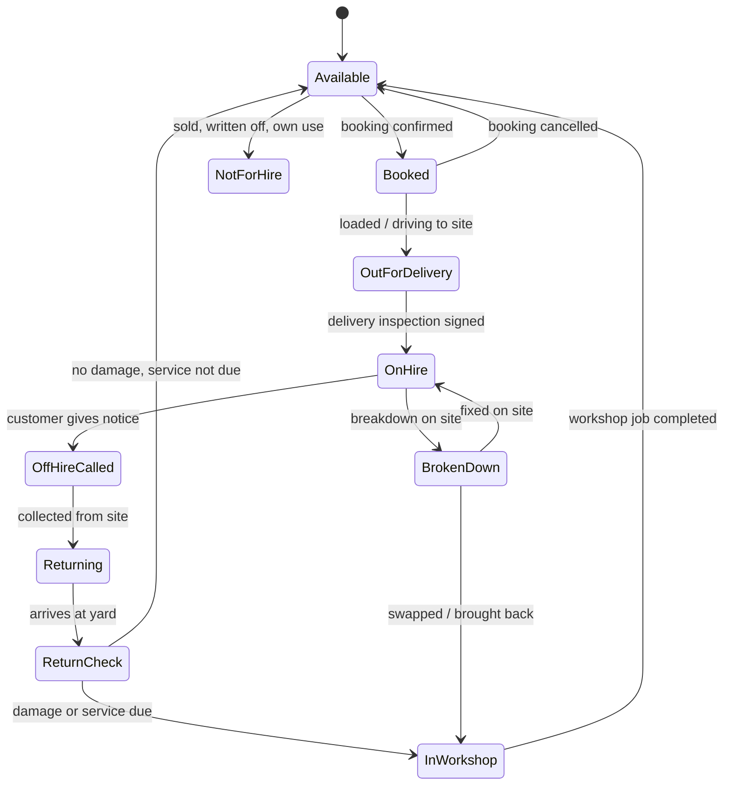
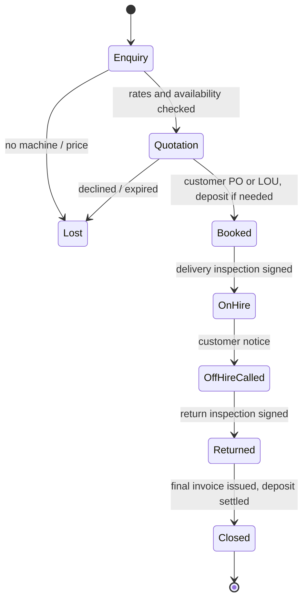
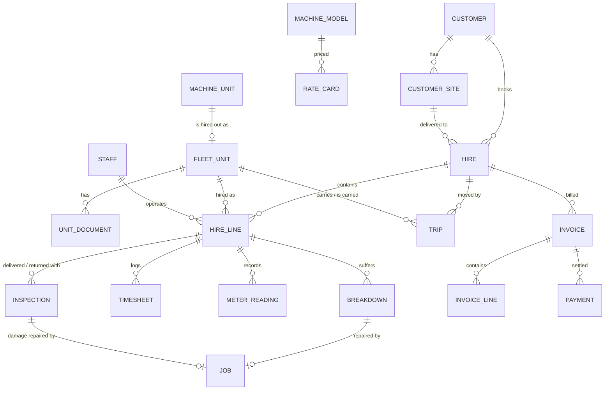

# Heavyworks Rental: Machinery Hire Module Design

Software for hiring out our own fleet of cranes, excavators, loaders, forklifts, lifts and generators to customers in Malaysia. It covers four kinds of hire: **dry hire** (machine only), **wet hire** (machine with our operator), **transport** (lowloader delivery and collection) and **long-term contracts** (monthly hire with an hour allowance).

It is a **module of Heavyworks Garage**, not a separate system. It shares the same login, roles, languages (English, Bahasa Melayu, Chinese), companies, machines and staff. The workshop and the rental desk see the same machine, so:

- a machine that breaks down on hire becomes an emergency job in the workshop
- a machine that comes back damaged becomes a chargeable repair job
- a machine that is due for service cannot be booked out until it is done

A clickable prototype lives in [`prototype/rental.html`](../prototype/rental.html).

---

## 1. Goals

1. **Know in one glance which machine is free, when.** A planner shows every fleet machine against the calendar: on hire, booked, in transit, in the workshop or free. Answering "do we have a 25-tonne crane from 2 to 13 November?" should take seconds.
2. **Never miss a billable hour.** Hire days, hour-meter readings and operator timesheets are captured on the phone, signed by the customer on site, and flow straight into the invoice.
3. **Bill correctly the first time.** Rate cards, minimum hours, overtime, Sunday/public-holiday rates, rain standby, breakdown credits, transport and damages are worked out by the system, not by hand in Excel. Invoices carry SST and go to LHDN MyInvois as e-invoices.
4. **Hand over and take back properly.** Every delivery and return has a checklist, photos, hour meter, fuel level and the customer's signature, so a damage dispute is settled with evidence.
5. **Stay legal.** No machine goes out with an expired DOSH Certificate of Fitness, road tax or insurance. No operator goes out with an expired competency certificate, CIDB card or driving licence.
6. **Know which machines earn their keep.** Each machine's hire revenue and its workshop costs sit side by side, so the owner can decide what to buy, keep or sell.

---

## 2. Kinds of hire and how they are charged

| Kind | What the customer gets | Charged by | Typical machines |
|---|---|---|---|
| **Dry hire** | Machine only. Customer's operator, customer's diesel. | Day, week or month. Hour meter checked against the monthly hour allowance | Excavators, loaders, forklifts, boom lifts, generators |
| **Wet hire** | Machine plus our operator (and rigger/signalman if asked). | Hour (with a daily minimum), day or month, from signed timesheets | Mobile cranes, lorry cranes, excavators on short jobs |
| **Transport** | Lowloader delivery and collection, mobilisation of self-drive cranes. | Per trip by zone or distance, plus permits and escort | Anything we move to site |
| **Long-term contract** | Monthly hire for a fixed term (3–24 months), dry or wet, renewing each month. | Monthly rate covering an hour allowance (e.g. 200 h), hours above it charged as excess | Excavators in quarries, forklifts at warehouses, cranes on long projects |

A single hire can mix these. One customer agreement, for example, can cover a mini excavator (dry, weekly), a wheel loader (dry, weekly) and the lowloader trips for both.

### 2.1 Charging rules

All of these are settings the Head Manager can change (Rates → Charging rules). The defaults below reflect common practice in Peninsular Malaysia.

| Rule | Default | Notes |
|---|---|---|
| Working day | 8 hours, Monday–Saturday | Hours above 8 on a day are overtime |
| Hourly hire minimum | 4 hours per call-out | For lorry cranes and short wet-hire jobs |
| Monthly hire | Covers 200 machine hours (≈ 26 working days × 8 h) | Partial months charged by calendar days |
| Excess hours (monthly) | Hours above 200 at the excess hourly rate | Read from hour meter (dry) or timesheets (wet) |
| Weekly hire | 7 calendar days | Remaining days at day rate, never more than a full week |
| Overtime | Overtime hourly rate per model | Wet hire only. Operator OT is included in this rate |
| Sundays and public holidays | ×1.5 on the day rate | Wet hire. Public holidays follow the **state** of the site (e.g. Thaipusam is not a holiday in every state) |
| Rain / site standby | 50% of the hourly rate | Wet hire: machine and operator on site but cannot work. Must be ticked on the timesheet and signed |
| Breakdown credit | Hours lost through our breakdown are not charged, after the first 2 h of a day | Opening a breakdown automatically records lost time and creates a workshop emergency job |
| Operator outstation allowance | RM 80 per night | Wet hire outside the home zone (meals and lodging) |
| Diesel | Customer supplies (dry hire); included or charged at cost + 10% (wet hire) | Fuel level recorded at delivery and return; shortfall charged |
| Cleaning | RM 150–500 by machine size | Only if returned excessively dirty, with photos |
| Damages | Workshop repair cost (parts + labour at selling price) | Comes from the linked workshop job |
| Deposit | 1 month's hire for new customers or customers over their credit limit | Held and set against the final invoice |
| Late return | Day rate for each day after the agreed off-hire date without notice | |

---

## 3. Roles and permissions

The same chain of command as the workshop, with three people added: **operators**, **lowloader drivers** and the **rental desk**. The rental desk is a responsibility, not a separate role: it is given to the Supervisor, or to an office administrator who gets the Supervisor role without workshop rights.

| Capability | Head Manager | Supervisor / Rental desk | Operator | Driver | Mechanic |
|---|:-:|:-:|:-:|:-:|:-:|
| See planner and fleet availability | ✓ | ✓ | – | – | View |
| Create quotations and bookings | ✓ | ✓ | – | – | – |
| Give a discount below the rate card | ✓ | Up to 10% | – | – | – |
| Override a block (expired document, credit limit) | ✓ | – | – | – | – |
| Assign operators and transport | ✓ | ✓ | – | – | – |
| Delivery / return inspection with photos | ✓ | ✓ | ✓ (own hire) | ✓ (own trip) | ✓ |
| Fill in daily timesheet, get customer signature | ✓ | ✓ | ✓ (own) | – | – |
| See rates, hire value, invoices | ✓ | ✓ | – | – | – |
| See machine cost, workshop cost per machine, profit | ✓ | – | – | – | – |
| Billing run, issue invoices, credit notes | ✓ | Prepare | – | – | – |
| Edit rate card and charging rules | ✓ | – | – | – | – |

Operators and drivers use a phone and see only their own hires and trips, with **no prices**, the same as mechanics in the workshop.

---

## 4. Fleet machines and their status

A fleet machine is a normal machine record (same plate, photos, service schedule and workshop history) with a **fleet number** (e.g. `RC-01` for rough-terrain crane 1) and the company set to our own company. Customer machines are never offered for hire.

Every fleet machine has exactly one **hire status** at any moment:

| Status | Set by | Shown on planner as |
|---|---|---|
| Available | System | Empty row |
| Booked | Rental desk | Hatched bar from delivery to planned return |
| Out for delivery / Returning | Driver | Small truck marker on the day |
| On hire | Inspection signed | Solid bar, colour by hire kind |
| Off-hire called | Rental desk | Bar end turns to the off-hire date with a flag |
| Broken down | Operator or customer call | Red segment on the bar; the hours stop being charged |
| Return check | Yard / mechanic | Grey block |
| In workshop | Workshop job | Grey block linked to the job; ends at the job's due date |
| Not for hire | Head Manager | Row greyed out |

**Blocks** that stop a machine from being booked for a date range:
- a DOSH Certificate of Fitness (lifting machinery), road tax, insurance or Puspakom inspection that expires before the hire ends
- a workshop job that is open on those dates
- a service due during the hire (warning only: the booking can go ahead with the service done on site)

The Head Manager can override a warning with a reason. An expired DOSH Certificate of Fitness cannot be overridden.

---

## 5. Hire lifecycle

1. **Enquiry.** Customer calls or WhatsApps: what machine, where, from when, how long, dry or wet. The desk opens *New hire*, picks the machine type and dates, and sees straight away which machines are free (and which are free except for a short overlap).
2. **Quotation.** The system takes the prices from the rate card for the chosen basis (hour / day / week / month), adds transport by zone and the deposit, and works out an estimate. The quotation PDF goes out by WhatsApp or e-mail in the customer's language. *Lost* enquiries record the reason: no machine available, price, or customer went elsewhere. Reports use these reasons for fleet planning.
3. **Booked.** The customer's PO number or Letter of Undertaking is attached. The machine is reserved on the planner. If the customer is new or over their credit limit, the booking waits for the deposit (or Head Manager approval).
4. **Delivery and on-hire.** The lowloader trip is scheduled. At site, the driver or operator does the **delivery inspection** on the phone and the customer's site supervisor signs. The hire clock starts from that signature.
5. **On hire.** Wet hire: the operator fills in a timesheet every day and the site supervisor signs it. Dry hire: the hour meter is read at least once a month (photo), and at return. A breakdown is reported from the phone and starts a workshop emergency job.
6. **Off-hire called.** The customer gives notice by phone, WhatsApp or the off-hire link. The off-hire date is recorded (hire charges stop on that date even if collection is later), and a collection trip is scheduled.
7. **Returned.** The **return inspection** is done at the yard (or on site before loading): the same checklist, photos, hour meter and fuel. Damages create a workshop job marked *chargeable to hire H-2026-0148*.
8. **Closed.** The final invoice includes the last part-month, excess hours, fuel shortfall and damages (when the workshop job is done), less the deposit.

Hire number: `H-YYYY-NNNN`, running per year (same pattern as jobs `J-YYYY-NNNN`).

**Swapping a machine.** During a hire, a machine can be swapped for another of the same type (breakdown, or customer wants a bigger one). The hire keeps its number; each machine has its own on-hire and off-hire dates.

**Extending.** Changing the planned end date warns if the machine is booked for someone else straight after.

---

## 6. Inspections: delivery and return

One phone form for both, filled in at the machine:

| Section | Contents |
|---|---|
| Readings | Hour meter (with photo), fuel level (¼ steps, with photo), odometer for road-going units |
| Photos | Four sides, cab, attachment(s). Compulsory before signing |
| Checklist | Engine oil, coolant and hydraulic levels; leaks; tyres or tracks; lights and horn; reverse alarm and beacon; fire extinguisher; for cranes: LMI/SLI working, load chart, hook and wire rope, outrigger pads, copy of the DOSH Certificate of Fitness in the cab |
| Attachments | Bucket, forks, jib, slings, outrigger mats: ticked out and ticked back in |
| Damage | Tap on a machine outline to mark damage, with a photo and note. Return inspection shows the delivery photos alongside for comparison |
| Signatures | Our person and the customer's representative (name, IC last 4 digits, signature on the phone) |

The signed delivery form becomes the **Delivery Order** and the return form becomes the **Return Note**. Both are PDFs sent to the customer by WhatsApp straight away.

---

## 7. Operator timesheets (wet hire)

A daily form on the operator's phone, which works offline and syncs when back in signal:

- start and finish time, meal break
- hour meter start and finish (optional when the meter is broken)
- standby hours (rain, site not ready, waiting for materials) with a reason
- breakdown hours (links to the workshop job)
- work done (short note, e.g. "lifting steel trusses grid C–F")
- **site supervisor signs** on the operator's phone. If nobody is available to sign, the timesheet is sent to the customer's contact by WhatsApp to approve with one tap

The rental desk sees missing and unsigned timesheets on the Today screen. Signed timesheets are locked, and changing one needs the Head Manager. The hours also update the machine's hour meter, which moves the service schedule.

Operators and riggers also get **site allowances** and **overtime** for payroll from the same timesheets. The payroll export lists hours by person and type.

---

## 8. Transport

- **Our transport vehicles** (prime movers, lowloaders, lorry cranes) are fleet machines marked *transport*. They are scheduled, not hired out.
- A **trip** has a direction (delivery / collection / transfer between sites), date and time window, vehicle, driver, machine(s), from and to (with map pin), and a charge.
- Charges by **zone** (Klang Valley, Negeri Sembilan, Perak, Johor…) or distance band, set per machine size (up to 10 t, 10–30 t, over 30 t). Self-drive cranes are charged **mobilisation / demobilisation**.
- **Permits:** oversize loads need a JPJ special permit and sometimes a police escort. The trip shows the permit number and escort booking, and the charge is passed on.
- The driver's phone shows today's trips, the site contact and the pin, and records departure, arrival and the delivery/return inspection.
- Vehicle documents tracked: road tax, insurance, Puspakom inspection, APAD operator licence, and the driver's GDL licence.

---

## 9. Billing

### 9.1 Invoices

- **Billing cycle per hire:** monthly in arrears (long hire, the usual), at the end of the hire (short hire), or in advance (monthly, for customers with no credit history).
- **Billing run:** on the 1st of each month, the system prepares draft invoices for every hire. It fills them from the rate card snapshot taken when the hire was booked, the signed timesheets, hour-meter readings, trips, and approved extras. The desk checks the exceptions (missing timesheets, unsigned days, open damages) and the Head Manager issues the invoices.
- **Lines:** hire per machine and period, excess / overtime hours, Sunday and public holiday hours, standby, *less* breakdown credit, operator allowance, transport, fuel, cleaning, damages, *less* deposit applied.
- **Credit notes** for disputes and corrections. An issued invoice is never edited.
- **Statement of account** and **ageing** (current, 30, 60, 90+ days) per customer. A customer over their credit limit or 60+ days overdue is flagged at booking.
- **Accounting export** to AutoCount / SQL Accounting / Xero (same as the workshop), so nothing is typed twice.

### 9.2 Malaysian tax and e-invoicing

| Item | Design |
|---|---|
| **SST** | Rental and leasing of machinery became a taxable service at **8%** from 1 July 2025 for registered businesses above the RM 1 million threshold. Our SST registration number goes on every invoice. Each charge type (hire, transport, fuel, damages) has its own *taxable / not taxable* setting and rate, because not every line may be taxable. **The tax agent should confirm these settings before go-live.** |
| **LHDN e-Invoice (MyInvois)** | Every invoice and credit note is submitted to MyInvois, either directly through the API or through the accounting software if it already does this. The validated **UUID and QR code** are printed on the PDF. Status is shown per invoice: Pending, Validated, Rejected (with reason), Cancelled (within 72 hours). |
| **Buyer details needed** | Customer SSM registration no. (BRN), **TIN**, SST no. (if any), address and contact. A customer without a TIN cannot be invoiced, so the TIN is asked for at booking, not at billing. |
| **Our details** | Company name, SSM no., TIN, SST no., **MSIC code** (77300: renting of other machinery, equipment), set in Settings. |
| **Deposits** | Recorded as a receipt and applied to the final invoice (an e-invoice is issued for the deposit only if the tax agent advises it). |

---

## 10. Documents and compliance

| Machine documents | Who issues | Rule in the system |
|---|---|---|
| DOSH Certificate of Fitness (CF / PMA) | DOSH (JKKP), for cranes and other lifting machinery | Expired: cannot go on hire. Warn 60 days ahead so the inspection is booked |
| Road tax and insurance | JPJ / insurer, for road-registered units | Expired: cannot travel or go on hire |
| Puspakom inspection | For lorry cranes, prime movers and lowloaders | Expired: cannot be used for transport |
| Contractor's plant & machinery insurance | Insurer | Warn; Head Manager can override |
| Load test and wire rope certificates | Third-party inspector | Warn |

| Operator / driver documents | Rule |
|---|---|
| DOSH competency (mobile crane operator, etc.) | Required for crane wet hire. Expired: cannot be assigned |
| CIDB green card (Kad Hijau) | Required on construction sites |
| Driving licence and GDL | Required for drivers and self-drive cranes |
| Work permit (foreign workers) | Already tracked in Team. Expired: cannot be assigned |
| Site inductions (per customer site, e.g. Petronas, port) | Optional, shown when assigning |

These go in the same certificate list as the workshop staff's (Team → Certificates) and machine documents go on the machine page. The **Today** screen lists everything expiring in 60 days.

---

## 11. Screens

| Screen | For | What it shows |
|---|---|---|
| **Today** | Head Manager, desk | Going out today, coming back today, off-hire notices, missing / unsigned timesheets, breakdowns on hire, bookings waiting for deposit, documents expiring, invoices overdue, machines idle 14+ days. Counts: on hire, available, utilisation this month |
| **Planner** | Head Manager, desk, workshop (view) | Gantt of every fleet machine over 6 weeks, grouped by type. Bars for hires, bookings, workshop and transport. "Find a machine" for a type and dates highlights the free ones |
| **Hires** | Head Manager, desk | List by status. Hire page: customer, site, machines, rates, operator, inspections, timesheets, trips, charges to date, documents, activity log |
| **New hire / quotation** | Head Manager, desk | One page: customer (or new one), site, type and dates → available machines → basis and rates (from the rate card) → operator → transport → estimate → save as quotation or booking |
| **Fleet** | All office | Every fleet machine with status, where it is, until when, documents and next service. Machine page adds hire history, utilisation, and (Head Manager) revenue vs workshop cost |
| **Transport** | Desk, drivers | Trips by day with vehicle, driver, permit, status |
| **Timesheets** | Operators (phone), desk | Operator: today's form and signature. Desk: matrix of hires × days showing signed / unsigned / missing |
| **Billing** | Head Manager, desk | Billing run with exceptions, invoices with MyInvois status, ageing, deposits |
| **Rates** | Head Manager (edit), desk (view) | Rate card per model, transport zones, charging rules |
| **Reports** | Head Manager | Utilisation, revenue and profit per machine, lost enquiries, customer ranking, ageing |

---

## 12. Reports

- **Time utilisation** per machine and type: days on hire ÷ days available (excludes Not for hire). Target lines (e.g. 70%).
- **Financial utilisation:** hire revenue ÷ machine purchase cost per year. Shows which machines pay for themselves.
- **Profit per machine** (Head Manager): hire revenue − workshop cost (parts + labour from workshop jobs on that machine) − transport cost − operator cost. The workshop data makes this possible.
- **Idle machines:** days since last on hire.
- **Lost enquiries** by machine type and reason. Repeated "no machine available" for 50 t cranes means buy or cross-hire another.
- **Customer ranking** by revenue, and **ageing / bad payers**.
- **Breakdowns on hire** per machine: lost hours and credit given.
- **Operator hours** per person (for payroll and fatigue).

---

## 13. Data model (additions)

| Table | Key fields |
|---|---|
| `fleet_units` | unit_id (→ machine_units), fleet_no, hire_status, kind (hire / transport), home_yard, purchase_date, purchase_cost (Head Manager only), active |
| `rate_cards` | model_id or machine type, hire_kind (dry / wet), hourly, min_hours, daily, weekly, monthly, monthly_hours, excess_hourly, ot_hourly, standby_pct, valid_from |
| `unit_documents` | unit_id, kind (cf, road_tax, insurance, puspakom, cpm_insurance, load_test), number, issued, expiry, file_path |
| `customers` (add) | brn, tin, sst_no, credit_terms_days, credit_limit, deposit_required, billing_contact, e-invoice e-mail |
| `customer_sites` | customer_id, name, address, state (for public holidays), lat/lng, site contact and phone, zone |
| `hires` | hire_no, customer_id, site_id, status, kind (dry / wet / mixed), po_no, quote_valid_until, start_planned, end_planned, billing_cycle, deposit, lost_reason, created_by |
| `hire_lines` | hire_id, fleet_unit_id (null while only a type is requested), machine_type, basis (hour / day / week / month), rate snapshot (jsonb), operator_id, on_hire_at, off_hire_called_at, off_hire_at, discount_pct |
| `inspections` | hire_line_id, kind (delivery / return), at, hour_meter, fuel_eighths, checklist (jsonb), attachments (jsonb), damage (jsonb), photos, our_staff_id, customer_name, customer_signature_path, job_id (damage) |
| `timesheets` | hire_line_id, date, operator_id, start, finish, break_mins, hm_start, hm_end, work_hours, standby_hours, standby_reason, breakdown_hours, note, status (draft / signed / approved_by_link / disputed), signed_name, signature_path, locked_at |
| `meter_readings` | hire_line_id, at, hour_meter, photo_path, by |
| `breakdowns` | hire_line_id, reported_at, fixed_at, lost_hours, cause, job_id, swapped_to_line_id |
| `trips` | hire_id, direction, date, window, vehicle_unit_id, driver_id, from, to, distance_km, zone, permit_no, escort, charge, status (planned / on_the_way / done) |
| `invoices` | invoice_no, customer_id, hire_id, period_from, period_to, issued_at, due_at, subtotal, sst, total, status, einvoice_uuid, einvoice_status, einvoice_validated_at, einvoice_qr |
| `invoice_lines` | invoice_id, kind (hire, excess, ot, sunday_ph, standby, breakdown_credit, allowance, transport, fuel, cleaning, damage, deposit), description, qty, unit, rate, amount, taxable, sst_rate, source ref |
| `payments` | customer_id, invoice_id, date, amount, method, reference |

Fleet machines keep their `machine_units` row (customer = our own company) so the workshop pages, service schedule and history work unchanged. The **rate snapshot** on each hire line means later rate card changes never change a running hire's price.

---

## 14. Malaysian practicalities built in

- **Languages:** the operator and driver screens, inspection forms, timesheets and WhatsApp messages come in English, Bahasa Melayu and Chinese, using each person's or customer's language setting.
- **WhatsApp first:** quotation, delivery order, daily timesheet copy, off-hire confirmation, invoice and statement are sent by WhatsApp, with e-mail as a backup.
- **Public holidays by state**, kept as a yearly list in Settings, including replacement holidays.
- **Monsoon / rain standby** recorded on timesheets with a reason, so the rain policy agreed with the customer is applied consistently.
- **Phone-first, offline:** quarries, plantations and port areas often lose signal. Inspections and timesheets save on the phone and send when back online.
- **Money in RM** with two decimals; documents show company SSM no., TIN and SST no.

---

## 15. Rollout plan

| Phase | Scope | Outcome |
|---|---|---|
| R1 — Fleet and planner (3–4 weeks) | Fleet machines, hire status, documents and expiry, planner, hires and quotations, rate card | Whiteboard / Excel booking sheet retired; no double bookings |
| R2 — On site (3–4 weeks) | Delivery and return inspections, operator timesheets with signature, breakdowns → workshop jobs, damages → workshop jobs, transport trips | Every billable hour and every damage captured with evidence |
| R3 — Billing (3–4 weeks) | Billing run, invoices, SST, credit notes, deposits, statements, ageing, accounting export, MyInvois e-invoice | Invoices out on the 1st, no retyping |
| R4 — Extras | Off-hire link and customer portal, telematics hour meters, profit per machine, payroll export, lost-enquiry reports | Fewer calls; fleet decisions based on numbers |

Before R1, load: the fleet list with fleet numbers, every machine's documents and expiry dates, the current rate card, and all hires currently running (with their start dates and last billed date).

---

## 16. Open questions for the owner

1. How many machines are in the hire fleet, and do we cross-hire machines in from other companies when we run short?
2. Which machines are only wet hire (cranes?) and which are only dry hire?
3. How is a month counted today: calendar month, 26 days or 30 days? How many hours does the monthly rate cover?
4. What is the rain / standby policy, and does it differ per customer?
5. Is SST registration in place for rental services, and which accounting software sends e-invoices to MyInvois today?
6. Are operators paid overtime and site allowances from the hire timesheets?
7. Does the company run its own lowloaders, or use a transport subcontractor (whose cost we pass on)?
8. Is a customer deposit always taken, or only for new customers?
