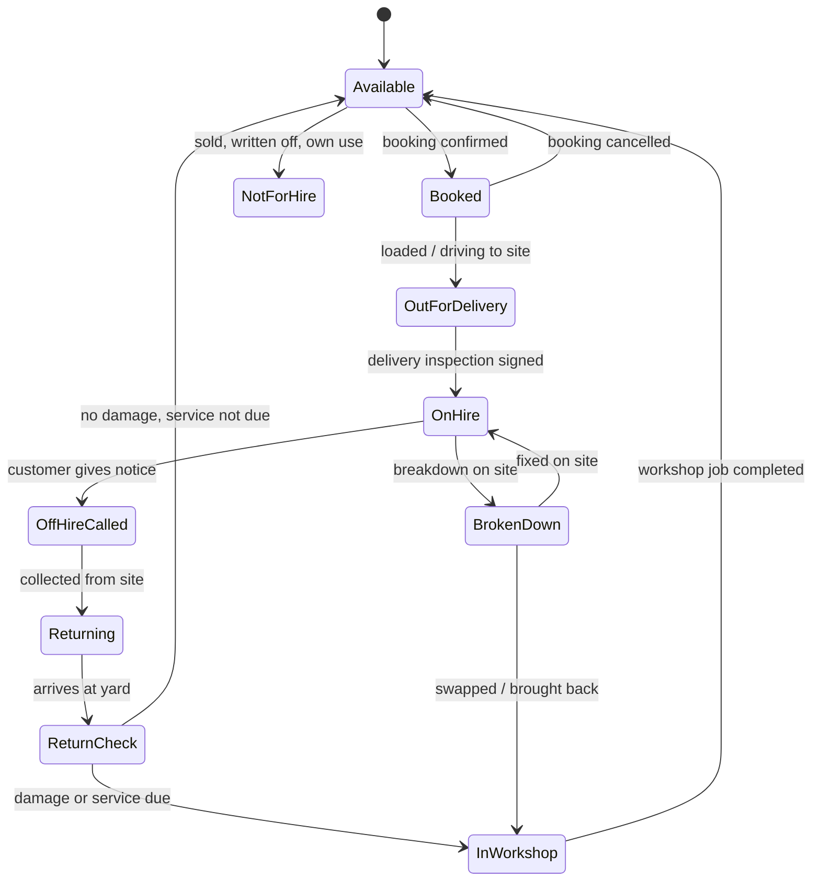
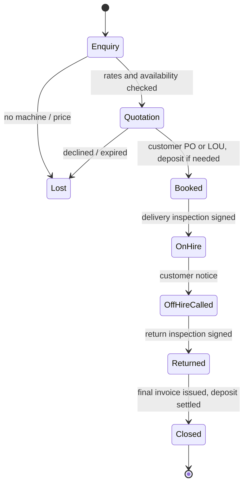
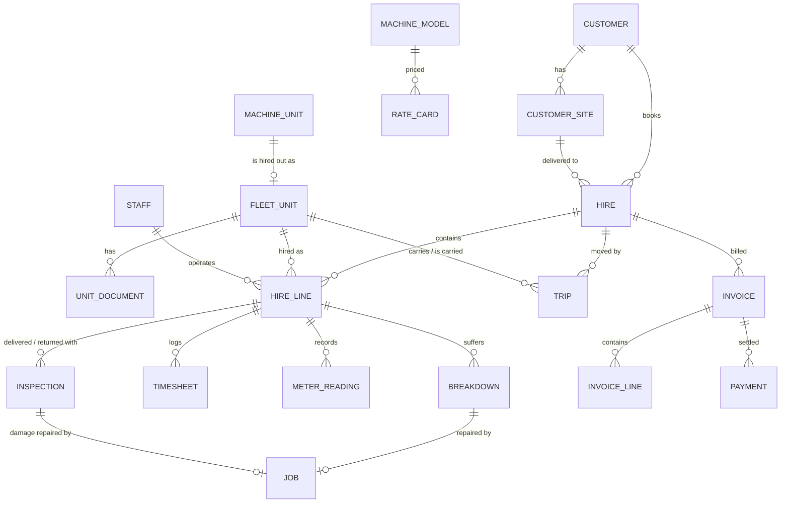

# Super Power Crane Machinery Sdn Bhd: Rental System Design

Software for running a heavy machinery rental business in Malaysia: customer enquiries and follow-ups, quotations and orders (hires), the fleet and its bookings, delivery and return, operators and drivers, staff rosters and leave, a shared calendar of everything that is happening, billing and reports. The fleet is cranes, excavators, loaders, forklifts, lifts and generators. It covers four kinds of hire: **dry hire** (machine only), **wet hire** (machine with our operator), **transport** (lowloader delivery and collection) and **long-term contracts** (monthly hire with an hour allowance).

The system is for **Super Power Crane Machinery Sdn Bhd**. It is built as a module of the Heavyworks Garage workshop system in this repository, not a separate system. It shares the same login, roles, languages (English, Bahasa Melayu, Chinese), companies, machines and staff. The workshop and the rental desk see the same machine, so:

- a machine that breaks down on hire becomes an emergency job in the workshop
- a machine that comes back damaged becomes a chargeable repair job
- a machine that is due for service cannot be booked out until it is done

A clickable prototype lives in [`prototype/rental.html`](../prototype/rental.html).

**The whole process, end to end:**

```
Enquiry ─► Follow-ups ─► Quotation ─► Order (booking, PO / LOU, deposit) ─► Delivery + inspection
   │                                                                            │
   └─ Lost (reason) ──► fleet report                     On hire: timesheets, meter readings, breakdowns
                                                                                │
       Statement, payment chase ◄─ Invoice + e-invoice ◄─ Return + inspection ◄─ Off-hire notice
```

Every step creates the next follow-up automatically, puts itself on the calendar, and books the people and vehicles it needs on the staff roster.

---

## 1. Goals

1. **Know in one glance which machine is free, when.** A planner shows every fleet machine against the calendar: on hire, booked, in transit, in the workshop or free. Answering "do we have a 25-tonne crane from 2 to 13 November?" should take seconds.
2. **Never miss a billable hour.** Hire days, hour-meter readings and operator timesheets are captured on the phone, signed by the customer on site, and flow straight into the invoice.
3. **Bill correctly the first time.** Rate cards, minimum hours, overtime, Sunday/public-holiday rates, rain standby, breakdown credits, transport and damages are worked out by the system, not by hand in Excel. Invoices carry SST and go to LHDN MyInvois as e-invoices.
4. **Hand over and take back properly.** Every delivery and return has a checklist, photos, hour meter, fuel level and the customer's signature, so a damage dispute is settled with evidence.
5. **Stay legal.** No machine goes out with an expired DOSH Certificate of Fitness, road tax or insurance. No operator goes out with an expired competency certificate, CIDB card or driving licence.
6. **Know which machines earn their keep.** Each machine's hire revenue and its workshop costs sit side by side, so the owner can decide what to buy, keep or sell.

---

## 2. Kinds of hire and how they are charged

| Kind | What the customer gets | Charged by | Typical machines |
|---|---|---|---|
| **Dry hire** | Machine only. Customer's operator, customer's diesel. | Day, week or month. Hour meter checked against the monthly hour allowance | Excavators, loaders, forklifts, boom lifts, generators |
| **Wet hire** | Machine plus our operator (and rigger/signalman if asked). | Hour (with a daily minimum), day or month, from signed timesheets | Mobile cranes, lorry cranes, excavators on short jobs |
| **Transport** | Lowloader delivery and collection, mobilisation of self-drive cranes. | Per trip by zone or distance, plus permits and escort | Anything we move to site |
| **Long-term contract** | Monthly hire for a fixed term (3–24 months), dry or wet, renewing each month. | Monthly rate covering an hour allowance (e.g. 200 h), hours above it charged as excess | Excavators in quarries, forklifts at warehouses, cranes on long projects |

A single hire can mix these. One customer agreement, for example, can cover a mini excavator (dry, weekly), a wheel loader (dry, weekly) and the lowloader trips for both.

### 2.1 Charging rules

All of these are settings the Head Manager can change (Rates → Charging rules). The defaults below reflect common practice in Peninsular Malaysia.

| Rule | Default | Notes |
|---|---|---|
| Working day | 8 hours, Monday–Saturday | Hours above 8 on a day are overtime |
| Hourly hire minimum | 4 hours per call-out | For lorry cranes and short wet-hire jobs |
| Monthly hire | Covers 200 machine hours (≈ 26 working days × 8 h) | Partial months charged by calendar days |
| Excess hours (monthly) | Hours above 200 at the excess hourly rate | Read from hour meter (dry) or timesheets (wet) |
| Weekly hire | 7 calendar days | Remaining days at day rate, never more than a full week |
| Overtime | Overtime hourly rate per model | Wet hire only. Operator OT is included in this rate |
| Sundays and public holidays | ×1.5 on the day rate | Wet hire. Public holidays follow the **state** of the site (e.g. Thaipusam is not a holiday in every state) |
| Rain / site standby | 50% of the hourly rate | Wet hire: machine and operator on site but cannot work. Must be ticked on the timesheet and signed |
| Breakdown credit | Hours lost through our breakdown are not charged, after the first 2 h of a day | Opening a breakdown automatically records lost time and creates a workshop emergency job |
| Operator outstation allowance | RM 80 per night | Wet hire outside the home zone (meals and lodging) |
| Diesel | Customer supplies (dry hire); included or charged at cost + 10% (wet hire) | Fuel level recorded at delivery and return; shortfall charged |
| Cleaning | RM 150–500 by machine size | Only if returned excessively dirty, with photos |
| Damages | Workshop repair cost (parts + labour at selling price) | Comes from the linked workshop job |
| Deposit | 1 month's hire for new customers or customers over their credit limit | Held and set against the final invoice |
| Late return | Day rate for each day after the agreed off-hire date without notice | |

---

## 3. Roles and permissions

The same chain of command as the workshop, with these people added: **sales / customer service**, **accounts**, **operators** and **lowloader drivers**. The rental desk (bookings, transport, timesheets) is given to the Supervisor, or to an office administrator who gets the Supervisor role without workshop rights.

| Capability | Head Manager | Supervisor / Rental desk | Sales | Operator | Driver | Mechanic |
|---|:-:|:-:|:-:|:-:|:-:|:-:|
| Log enquiries, follow-ups, customer notes | ✓ | ✓ | ✓ | – | – | – |
| Staff roster, approve leave | ✓ | ✓ | – | – | – | – |
| Apply for leave, clock in | ✓ | ✓ | ✓ | ✓ | ✓ | ✓ |
| See planner and fleet availability | ✓ | ✓ | ✓ | – | – | View |
| Create quotations and bookings | ✓ | ✓ | ✓ | – | – | – |
| Give a discount below the rate card | ✓ | Up to 10% | Up to 5% | – | – | – |
| Override a block (expired document, credit limit) | ✓ | – | – | – | – | – |
| Assign operators and transport | ✓ | ✓ | – | – | – | – |
| Delivery / return inspection with photos | ✓ | ✓ | – | ✓ (own hire) | ✓ (own trip) | ✓ |
| Fill in daily timesheet, get customer signature | ✓ | ✓ | – | ✓ (own) | – | – |
| See rates, hire value, invoices | ✓ | ✓ | ✓ (own customers' balances) | – | – | – |
| See machine cost, workshop cost per machine, profit | ✓ | – | – | – | – | – |
| Billing run, issue invoices, credit notes | ✓ | Prepare | – | – | – | – |
| Edit rate card and charging rules | ✓ | – | – | – | – | – |

Operators and drivers use a phone and see only their own hires and trips, with **no prices**, the same as mechanics in the workshop.

---

## 4. Fleet machines and their status

A fleet machine is a normal machine record (same plate, photos, service schedule and workshop history) with a **fleet number** (e.g. `RC-01` for rough-terrain crane 1) and the company set to our own company. Customer machines are never offered for hire.

Every fleet machine has exactly one **hire status** at any moment:



| Status | Set by | Shown on planner as |
|---|---|---|
| Available | System | Empty row |
| Booked | Rental desk | Hatched bar from delivery to planned return |
| Out for delivery / Returning | Driver | Small truck marker on the day |
| On hire | Inspection signed | Solid bar, colour by hire kind |
| Off-hire called | Rental desk | Bar end turns to the off-hire date with a flag |
| Broken down | Operator or customer call | Red segment on the bar; the hours stop being charged |
| Return check | Yard / mechanic | Grey block |
| In workshop | Workshop job | Grey block linked to the job; ends at the job's due date |
| Not for hire | Head Manager | Row greyed out |

**Blocks** that stop a machine from being booked for a date range:
- another booking or hire on those dates
- a workshop job that is open on those dates
- road tax or insurance that expires before the hire ends

**Red warnings** (the machine can still be booked, as the owner decided):
- a **DOSH Certificate of Fitness** or **Puspakom** inspection that has expired or expires during the hire. The machine is marked red with the reason on New hire / quotation, the planner search, enquiries and Lift check; the booking confirms the issue; a "Renew document" follow-up goes to the Supervisor (due 14 days before expiry, or today if already expired); and the hire page, Today and the Dashboard keep showing it in red until the document is renewed.
- a service due during the hire (the service can be done on site).

---

## 5. Hire lifecycle



1. **Enquiry.** Customer calls or WhatsApps: what machine, where, from when, how long, dry or wet. The desk opens *New hire*, picks the machine type and dates, and sees straight away which machines are free (and which are free except for a short overlap).
2. **Quotation.** The system takes the prices from the rate card for the chosen basis (hour / day / week / month), adds transport by zone and the deposit, and works out an estimate. The quotation PDF goes out by WhatsApp or e-mail in the customer's language. *Lost* enquiries record the reason: no machine available, price, or customer went elsewhere. Reports use these reasons for fleet planning.
3. **Booked.** The customer's PO number or Letter of Undertaking is attached. The machine is reserved on the planner. If the customer is new or over their credit limit, the booking waits for the deposit (or Head Manager approval).
4. **Delivery and on-hire.** The lowloader trip is scheduled. At site, the driver or operator does the **delivery inspection** on the phone and the customer's site supervisor signs. The hire clock starts from that signature.
5. **On hire.** Wet hire: the operator fills in a timesheet every day and the site supervisor signs it. Dry hire: the hour meter is read at least once a month (photo), and at return. A breakdown is reported from the phone and starts a workshop emergency job.
6. **Off-hire called.** The customer gives notice by phone, WhatsApp or the off-hire link. The off-hire date is recorded (hire charges stop on that date even if collection is later), and a collection trip is scheduled.
7. **Returned.** The **return inspection** is done at the yard (or on site before loading): the same checklist, photos, hour meter and fuel. Damages create a workshop job marked *chargeable to hire H-2026-0148*.
8. **Closed.** The final invoice includes the last part-month, excess hours, fuel shortfall and damages (when the workshop job is done), less the deposit.

Hire number: `H-YYYY-NNNN`, running per year (same pattern as jobs `J-YYYY-NNNN`).

**Swapping a machine.** During a hire, a machine can be swapped for another of the same type (breakdown, or customer wants a bigger one). The hire keeps its number; each machine has its own on-hire and off-hire dates.

**Extending.** Changing the planned end date warns if the machine is booked for someone else straight after.

---

## 6. Inspections: delivery and return

One phone form for both, filled in at the machine:

| Section | Contents |
|---|---|
| Readings | Hour meter (with photo), fuel level (¼ steps, with photo), odometer for road-going units |
| Photos | Four sides, cab, attachment(s). Compulsory before signing |
| Checklist | Engine oil, coolant and hydraulic levels; leaks; tyres or tracks; lights and horn; reverse alarm and beacon; fire extinguisher; for cranes: LMI/SLI working, load chart, hook and wire rope, outrigger pads, copy of the DOSH Certificate of Fitness in the cab |
| Attachments | Bucket, forks, jib, slings, outrigger mats: ticked out and ticked back in |
| Damage | Tap on a machine outline to mark damage, with a photo and note. Return inspection shows the delivery photos alongside for comparison |
| Signatures | Our person and the customer's representative (name, IC last 4 digits, signature on the phone) |

The signed delivery form becomes the **Delivery Order** and the return form becomes the **Return Note**. Both are PDFs sent to the customer by WhatsApp straight away.

---

## 7. Operator timesheets (wet hire)

A daily form on the operator's phone, which works offline and syncs when back in signal:

- start and finish time, meal break
- hour meter start and finish (optional when the meter is broken)
- standby hours (rain, site not ready, waiting for materials) with a reason
- breakdown hours (links to the workshop job)
- work done (short note, e.g. "lifting steel trusses grid C–F")
- **site supervisor signs** on the operator's phone. If nobody is available to sign, the timesheet is sent to the customer's contact by WhatsApp to approve with one tap

The rental desk sees missing and unsigned timesheets on the Today screen. Signed timesheets are locked, and changing one needs the Head Manager. The hours also update the machine's hour meter, which moves the service schedule.

Operators and riggers also get **site allowances** and **overtime** for payroll from the same timesheets. The payroll export lists hours by person and type.

---

## 8. Transport

- **Our transport vehicles** (prime movers, lowloaders, lorry cranes) are fleet machines marked *transport*. They are scheduled, not hired out.
- A **trip** has a direction (delivery / collection / transfer between sites), date and time window, vehicle, driver, machine(s), from and to (with map pin), and a charge.
- Charges by **zone** from the Kempas yard (Johor Bahru; Senai / Kulai / Pasir Gudang; rest of Johor; Melaka / Negeri Sembilan) or distance band, set per machine size (up to 10 t, 10–30 t, over 30 t). Self-drive cranes are charged **mobilisation / demobilisation**.
- **Permits:** oversize loads need a JPJ special permit and sometimes a police escort. The trip shows the permit number and escort booking, and the charge is passed on.
- The driver's phone shows today's trips, the site contact and the pin, and records departure, arrival and the delivery/return inspection.
- Vehicle documents tracked: road tax, insurance, Puspakom inspection, APAD operator licence, and the driver's GDL licence.

---

## 9. Billing

### 9.1 Invoices

- **Billing cycle per hire:** monthly in arrears (long hire, the usual), at the end of the hire (short hire), or in advance (monthly, for customers with no credit history).
- **Billing run:** on the 1st of each month, the system prepares draft invoices for every hire. It fills them from the rate card snapshot taken when the hire was booked, the signed timesheets, hour-meter readings, trips, and approved extras. The desk checks the exceptions (missing timesheets, unsigned days, open damages) and the Head Manager issues the invoices.
- **Lines:** hire per machine and period, excess / overtime hours, Sunday and public holiday hours, standby, *less* breakdown credit, operator allowance, transport, fuel, cleaning, damages, *less* deposit applied.
- **Credit notes** for disputes and corrections. An issued invoice is never edited.
- **Statement of account** and **ageing** (current, 30, 60, 90+ days) per customer. A customer over their credit limit or 60+ days overdue is flagged at booking.
- **Accounting:** invoices go to Bukku (section 24), so nothing is typed twice. Your quotation and invoice PDFs look like they come from Bukku. If so, the invoice number is Bukku's own and Bukku also handles the e-invoice.

### 9.1a Invoice format (copied from IV- 01158 2026)

**Header and top of the invoice**
- **Header:** logo, then the company name with Reg No, Sales Tax ID, Service Tax ID, TIN C6860756030, MSIC Code 43907, address, contact and website.
- **Title:** INVOICE.
- **BILL TO:** the customer's name and full address, so the customer record needs a billing address.
- **On the right:** NO., DATE, PAYMENT TERM and DUE DATE. The payment term is NET30 (the customer's credit days) or COD.
- **Numbering:** `IV- 01158 2026`, five digits plus the year.

**Lines: one per signed work order**
- **Columns:** NO., DESCRIPTION, QTY, UOM, U/PRICE, AMT, TAX AMT.
- **Daily wet hire:** each work order becomes its own line. It shows:
  - `DAILY RENTAL OF 80T MOBILE CRANE WITH OPERATOR @ AT PONTIAN`;
  - the date (20.10.2026);
  - `work order no.: plate` (167948: JRM 79);
  - the working times from the work order (8:00 - 12:00,13:00 - 17:00).
- **Overtime and Sunday:** each goes on its own line under that day, with the work order no. and how many hours after 5 pm.
- **Hourly hire:** one line per work order. It shows the minimum (3.5 h or 7.5 h) when that is what was charged.
- **Monthly hire:** one line per month with the date range, then an EXCESS HOURS line if needed.
- **Other lines:**
  - transport (mobilisation, or lowloader delivery / collection) with date and zone;
  - diesel supplied;
  - LESS: BREAKDOWN with the date and terms clause 18;
  - damage repair.
- **Totals:** SUBTOTAL, SERVICE TAX (6%), TOTAL.

**Bottom of the invoice**
- **The 5 standard notes:**
  - objections within 14 days;
  - interest of 1.5% a month;
  - bound by the terms;
  - crossed cheques, with the bank accounts (Public Bank 3112434006, RHB Bank 20129160014550);
  - the 2% tax exemption note dated 23 Jan 2026.
- **Signatures:** Authorised By and Received By.
- **e-Invoice QR:** if the customer has a TIN, the invoice is validated and the QR links to MyInvois. If not, the footer says "Not validated by LHDN. Scan within same month to convert into e-invoice."

**Work order numbers** are 6 digits, from the operator's work order. Each work order is used on one invoice line only, so it can't be billed twice.

### 9.2 Malaysian tax and e-invoicing

| Item | Design |
|---|---|
| **SST** | Rental and leasing of machinery became a taxable service at **8%** from 1 July 2025 for registered businesses above the RM 1 million threshold. Our quotation QT-01094 charges **6%** service tax on every line, including wet hire. The prototype follows the quotation and keeps the rate as a setting. **Ask the tax agent which rate applies to dry hire and to hire with an operator.** Our service tax ID goes on every invoice. Each charge type (hire, transport, fuel, damages) has its own *taxable / not taxable* setting and rate, because not every line may be taxable. **The tax agent should confirm these settings before go-live.** |
| **LHDN e-Invoice (MyInvois)** | Every invoice and credit note is submitted to MyInvois, either directly through the API or through the accounting software if it already does this. The validated **UUID and QR code** are printed on the PDF. Status is shown per invoice: Pending, Validated, **Not validated** (customer has no TIN; they scan the QR this month, otherwise it goes into the month's consolidated e-invoice; to confirm with Bukku), Rejected (with reason), Cancelled (within 72 hours). |
| **Buyer details needed** | Customer SSM registration no. (BRN), **TIN**, SST no. (if any), address and contact. A customer without a TIN can still be invoiced, as IV- 01158 2026 shows, but the invoice is not an e-invoice until they scan the QR. The TIN is asked for at booking, so most invoices are validated directly. |
| **Our details** | Super Power Crane Machinery Sdn Bhd, Reg No 199401026255 / 311936-K, Sales Tax ID J31-2507-32000161, Service Tax ID J31-2507-39000112, Lot 3013, Jalan Belati, Off Jalan Kempas Lama, Kawasan Perindustrian Maju Jaya, 81300 Johor Bahru, Johor; +60 19-728 0435, accounting@superpowercrane.com. TIN C6860756030, **MSIC code 43907** (from invoice IV- 01158 2026), bank accounts Public Bank 3112434006 and RHB Bank 20129160014550. All of these are set in Settings. |
| **Deposits** | Recorded as a receipt and applied to the final invoice (an e-invoice is issued for the deposit only if the tax agent advises it). |

---

## 10. Documents and compliance

| Machine documents | Who issues | Rule in the system |
|---|---|---|
| DOSH Certificate of Fitness (CF / PMA) | DOSH (JKKP), for cranes and other lifting machinery | Expired or expiring during a hire: can still be booked, marked red everywhere with a renewal follow-up. Warn 60 days ahead so the inspection is booked |
| Road tax and insurance | JPJ / insurer, for road-registered units | Expired: cannot travel or go on hire |
| Puspakom inspection | For lorry cranes, prime movers and lowloaders | Expired or expiring during a hire: can still be booked, marked red with a renewal follow-up |
| Contractor's plant & machinery insurance | Insurer | Warn; Head Manager can override |
| Load test and wire rope certificates | Third-party inspector | Warn |

| Operator / driver documents | Rule |
|---|---|
| DOSH competency (mobile crane operator, etc.) | Required for crane wet hire. Expired: cannot be assigned |
| CIDB green card (Kad Hijau) | Required on construction sites |
| Driving licence and GDL | Required for drivers and self-drive cranes |
| Work permit (foreign workers) | Already tracked in Team. Expired: cannot be assigned |
| Site inductions (per customer site, e.g. Petronas, port) | Optional, shown when assigning |

These go in the same certificate list as the workshop staff's (Team → Certificates) and machine documents go on the machine page. The **Today** screen lists everything expiring in 60 days.

---

## 11. Screens

| Screen | For | What it shows |
|---|---|---|
| **Enquiries** | Sales, desk, Head Manager | Pipeline board (New → Contacted → Site visit → Quoted → Negotiating → Won / Lost) with value, owner and next follow-up on each card; Follow-ups list (overdue, today, this week) |
| **Customers** | Sales, desk, Head Manager | Customer list with balance, last contact and next follow-up; customer page with contacts, sites, credit, open follow-ups and full history; prospects |
| **Calendar** | All office | Month view of trips, follow-ups, site visits, meetings, inspections, workshop, leave, company events and expiry dates; filter by type; add events |
| **Staff** | Head Manager, Supervisor | Week roster built from hires, trips and leave (with clashes); people with licences and today's attendance; leave requests to approve |
| **Today** | Head Manager, desk | Going out today, coming back today, off-hire notices, missing / unsigned timesheets, breakdowns on hire, bookings waiting for deposit, documents expiring, invoices overdue, machines idle 14+ days. Counts: on hire, available, utilisation this month |
| **Planner** | Head Manager, desk, workshop (view) | Gantt of every fleet machine over 6 weeks, grouped by type. Bars for hires, bookings, workshop and transport. "Find a machine" for a type and dates highlights the free ones |
| **Hires** | Head Manager, desk | List by status. Hire page: customer, site, machines, rates, operator, inspections, timesheets, trips, charges to date, documents, activity log |
| **New hire / quotation** | Head Manager, desk | One page: customer (or new one), site, type and dates → available machines → basis and rates (from the rate card) → operator → transport → estimate → save as quotation or booking |
| **Fleet** | All office | Every fleet machine with status, where it is, until when, documents and next service. Machine page adds hire history, utilisation, and (Head Manager) revenue vs workshop cost |
| **Transport** | Desk, drivers | Trips by day with vehicle, driver, permit, status |
| **Timesheets** | Operators (phone), desk | Operator: today's form and signature. Desk: matrix of hires × days showing signed / unsigned / missing |
| **Billing** | Head Manager, desk | Billing run with exceptions, invoices with MyInvois status, ageing, deposits |
| **Rates** | Head Manager (edit), desk (view) | Rate card per model, transport zones, charging rules |
| **Reports** | Head Manager | Utilisation, revenue and profit per machine, lost enquiries, customer ranking, ageing |

---

## 12. Reports

- **Time utilisation** per machine and type: days on hire ÷ days available (excludes Not for hire). Target lines (e.g. 70%).
- **Financial utilisation:** hire revenue ÷ machine purchase cost per year. Shows which machines pay for themselves.
- **Profit per machine** (Head Manager): hire revenue − workshop cost (parts + labour from workshop jobs on that machine) − transport cost − operator cost. The workshop data makes this possible.
- **Idle machines:** days since last on hire.
- **Lost enquiries** by machine type and reason. Repeated "no machine available" for 50 t cranes means buy or cross-hire another.
- **Customer ranking** by revenue, and **ageing / bad payers**.
- **Breakdowns on hire** per machine: lost hours and credit given.
- **Operator hours** per person (for payroll and fatigue).

---

## 13. Data model (additions)



| Table | Key fields |
|---|---|
| `fleet_units` | unit_id (→ machine_units), fleet_no, hire_status, kind (hire / transport), home_yard, purchase_date, purchase_cost (Head Manager only), active |
| `rate_cards` | model_id or machine type, hire_kind (dry / wet), hourly, min_hours, daily, weekly, monthly, monthly_hours, excess_hourly, ot_hourly, standby_pct, valid_from |
| `unit_documents` | unit_id, kind (cf, road_tax, insurance, puspakom, cpm_insurance, load_test), number, issued, expiry, file_path |
| `customers` (add) | brn, tin, sst_no, credit_terms_days, credit_limit, deposit_required, billing_contact, e-invoice e-mail |
| `customer_sites` | customer_id, name, address, state (for public holidays), lat/lng, site contact and phone, zone |
| `hires` | hire_no, customer_id, site_id, status, kind (dry / wet / mixed), po_no, quote_valid_until, start_planned, end_planned, billing_cycle, deposit, lost_reason, created_by |
| `hire_lines` | hire_id, fleet_unit_id (null while only a type is requested), machine_type, basis (hour / day / week / month), rate snapshot (jsonb), operator_id, on_hire_at, off_hire_called_at, off_hire_at, discount_pct |
| `inspections` | hire_line_id, kind (delivery / return), at, hour_meter, fuel_eighths, checklist (jsonb), attachments (jsonb), damage (jsonb), photos, our_staff_id, customer_name, customer_signature_path, job_id (damage) |
| `timesheets` | hire_line_id, date, operator_id, start, finish, break_mins, hm_start, hm_end, work_hours, standby_hours, standby_reason, breakdown_hours, note, status (draft / signed / approved_by_link / disputed), signed_name, signature_path, locked_at |
| `meter_readings` | hire_line_id, at, hour_meter, photo_path, by |
| `breakdowns` | hire_line_id, reported_at, fixed_at, lost_hours, cause, job_id, swapped_to_line_id |
| `trips` | hire_id, direction, date, window, vehicle_unit_id, driver_id, from, to, distance_km, zone, permit_no, escort, charge, status (planned / on_the_way / done) |
| `invoices` | invoice_no, customer_id, hire_id, period_from, period_to, issued_at, due_at, subtotal, sst, total, status, einvoice_uuid, einvoice_status, einvoice_validated_at, einvoice_qr |
| `invoice_lines` | invoice_id, kind (hire, excess, ot, sunday_ph, standby, breakdown_credit, allowance, transport, fuel, cleaning, damage, deposit), description, qty, unit, rate, amount, taxable, sst_rate, source ref |
| `payments` | customer_id, invoice_id, date, amount, method, reference |

Fleet machines keep their `machine_units` row (customer = our own company) so the workshop pages, service schedule and history work unchanged. The **rate snapshot** on each hire line means later rate card changes never change a running hire's price.

---

## 14. Malaysian practicalities built in

- **Languages:** the operator and driver screens, inspection forms, timesheets and WhatsApp messages come in English, Bahasa Melayu and Chinese, using each person's or customer's language setting.
- **WhatsApp first:** quotation, delivery order, daily timesheet copy, off-hire confirmation, invoice and statement are sent by WhatsApp, with e-mail as a backup.
- **Public holidays by state**, kept as a yearly list in Settings, including replacement holidays.
- **Monsoon / rain standby** recorded on timesheets with a reason, so the rain policy agreed with the customer is applied consistently.
- **Phone-first, offline:** quarries, plantations and port areas often lose signal. Inspections and timesheets save on the phone and send when back online.
- **Money in RM** with two decimals; documents show company SSM no., TIN and SST no.

---

## 15. Rollout plan

| Phase | Scope | Outcome |
|---|---|---|
| R1 — Customers, enquiries and fleet (4–5 weeks) | Customers and prospects, enquiries pipeline, follow-ups (manual and automatic), fleet machines, documents and expiry, planner, quotations and bookings, rate card, calendar | No enquiry forgotten; whiteboard / Excel booking sheet retired; no double bookings |
| R2 — On site (3–4 weeks) | Delivery and return inspections, operator timesheets with signature, breakdowns → workshop jobs, damages → workshop jobs, transport trips | Every billable hour and every damage captured with evidence |
| R3 — Billing (3–4 weeks) | Billing run, invoices, SST, credit notes, deposits, statements, ageing, accounting export, MyInvois e-invoice | Invoices out on the 1st, no retyping |
| R3b — Staff (2–3 weeks) | Roster, leave on the phone with approval, attendance, payroll export | Leave and assignments planned together; no clashes on the day |
| R4 — Extras | Off-hire link and customer portal, telematics hour meters, profit per machine, payroll export, lost-enquiry reports | Fewer calls; fleet decisions based on numbers |

Before R1, load: the fleet list with fleet numbers, every machine's documents and expiry dates, the current rate card, and all hires currently running (with their start dates and last billed date).

---

## 16. Customers, enquiries and follow-ups

**Customers.** Company name, SSM no., TIN, SST no., industry, salesperson, credit terms and limit, deposit rule, several contacts (office, site, accounts), sites with address and state, documents (SSM form, LOU templates), and notes. A **prospect** (asked but never hired) is kept on the enquiry until the first quotation, then becomes a customer.

**Enquiries** (`E-YYYY-NNNN`) come in by phone, WhatsApp, e-mail, website form, walk-in, referral or tender. Each records: who, what machine and how many, dry/wet, dates, site, details (loads, radius, ground, access), estimated value (from the rate card), owner, how hot (hot / warm / cold) and source. The availability of the requested type for those dates is shown on the enquiry, so the salesperson knows straight away whether to sell, offer other dates or another size, or cross-hire.

| Stage | Meaning | Likelihood used for the weighted pipeline |
|---|---|---|
| New | Just logged | 10% |
| Contacted | Called back, needs clarified | 20% |
| Site visit | Visit or lift plan needed | 40% |
| Quoted | Quotation sent (made from the enquiry, so nothing is retyped) | 50% |
| Negotiating | Price / terms being discussed | 70% |
| Won | Booking confirmed: the enquiry links to the hire (order) | 100% |
| Lost | With a reason: no machine free, price, went elsewhere, postponed, no reply | 0% |

**Follow-ups** are tasks with a date, type (call, WhatsApp, site visit, send quotation, send documents, chase PO, payment chase, meeting), owner and the enquiry, hire, invoice or customer they belong to. Every open enquiry must have a next follow-up; the pipeline flags those that don't. Follow-ups show on **Today**, on the **calendar**, on the customer page and in the owner's phone notifications. **Automatic follow-ups:**

| When | Follow-up created |
|---|---|
| New enquiry | Call back within 2 working hours (owner) |
| Quotation sent | Call after 2 days; again 1 day before it expires |
| Booking without PO / LOU | Chase PO 2 days before delivery |
| Hire ends within 7 days | Ask about extension or off-hire |
| Invoice overdue | Reminders at 7, 14 and 30 days (Accounts); Head Manager at 60 days |
| No hire for 90 days | Reactivation call by the salesperson |
| Enquiry lost for "no machine free" | Counted in the fleet report; call back if a machine frees up |

Follow-ups never fall on a Sunday or public holiday; they move to the next working day.

**Customer history** shows on one page: enquiries, quotations, hires, invoices and payments, follow-ups done, notes, complaints.

## 17. Staff: roster, leave and attendance

- **People:** profile, role, phone, IC / passport and work permit, licences and certificates with expiry (DOSH competency, CIDB green card, GDL, site inductions), skills (crane, earthmoving, lowloader), emergency contact.
- **Roster:** a week grid of every person. It is **built automatically** from hire assignments (operator on a wet hire), transport trips (driver) and leave; office staff show as office; anyone free shows as yard / standby, ready for a call-out. Clashes (leave on a day the person is on a hire) are shown in red.
- **Leave:** staff apply on the phone (annual, MC, emergency, unpaid, replacement). The Supervisor or Head Manager approves; the approval screen shows clashes and suggests a **relief operator** who is free and has the right competency. Balances are kept per person. Approved leave blocks the person from being assigned.
- **Attendance:** clock in / out on the phone with location (site or yard). For operators on wet hire, the signed timesheet is the attendance record.
- **Payroll export:** hours, overtime, Sunday / public holiday hours, outstation allowance, leave and MC per person per month, for the payroll software (EPF, SOCSO, EIS and PCB stay there).
- **Training and safety:** courses and toolbox talks recorded per person; certificates that expire block assignment (see section 10).

## 18. Calendar and events

One calendar for the whole company, month / week / day and a phone agenda, filterable by type and by person:

| Type | Comes from |
|---|---|
| Transport | Delivery and collection trips |
| Follow-up, site visit, meeting | Follow-ups and customer events |
| Inspection | DOSH CF inspections, Puspakom, load tests (booked before expiry) |
| Workshop | Machines going into the workshop (services, repairs) |
| Leave | Approved and requested leave |
| Company, training | Safety briefings, toolbox talks, courses, month-end planning |
| Expiry | Machine documents and staff certificates |

Anyone in the office can add an event; it can be linked to a customer or a machine. Reminders go by phone notification or WhatsApp the day before and an hour before.

## 19. Planning

- **Fleet planner** (section 11): every machine against the next six weeks.
- **Demand vs fleet:** for each machine type, how booked the next four weeks are, how many unit-days are free, and which open enquiries want it. It flags *tight* types (line up a cross-hire or decline) and *idle* types (promote to customers).
- **Staff planning:** the roster shows next week's operators and drivers against bookings and leave, so gaps are seen before the day.
- **Month-end planning meeting:** a printable summary of the coming month (bookings, hires ending, inspections due, leave, open quotations by value).

## 20. Data model (CRM and staff additions)

| Table | Key fields |
|---|---|
| `enquiries` | enquiry_no, customer_id or prospect (name, contact, phone), source, machine_type, qty, hire_kind, from, to, site, state, details, value_estimate, stage, temperature, owner_id, lost_reason, hire_id, received_at |
| `follow_ups` | due_date, due_time, type, owner_id, enquiry_id / hire_id / invoice_id / customer_id, text, rule (if automatic), done_at, done_note |
| `customer_contacts` | customer_id, name, role (office / site / accounts), phone, e-mail, WhatsApp opt-in |
| `customer_notes` | customer_id, at, by, text, kind (note / call / visit / complaint) |
| `events` | date, time, type, title, customer_id, unit_id, attendees, reminder |
| `leave_requests` | staff_id, type, from, to, days, note, status, decided_by, decided_at, mc_photo |
| `leave_balances` | staff_id, year, type, entitled, taken |
| `attendance` | staff_id, date, clock_in, clock_out, location (lat/lng, site or yard) |

## 21. Crane selector (lift check) and load charts

A page where the office types in a job's **load weight**, **working radius** and **lifting height** (plus rigging weight and the height of the load and slings), optionally the dates, and gets every crane in the fleet ranked, with the **closest fit** on top: the smallest crane that can do the lift and is free.

**Load charts.** Each crane in the fleet (Kato NK-250-5, Tadano TL-450-3, Kobelco RK500-2, Kato SS-500SP, Tadano TL-500-3, Tadano GR-600-1, Faun ATF 60-4, Kato SL-700, Sumitomo SA-1100, Kato SL-1300) has its rated capacity table entered once: boom lengths across, radii down, tonnes in the cells. A chart belongs to a **set-up** (outriggers fully extended / mid / minimum, 360° or over the rear, counterweight, jib), so a crane can have several charts; the main one is fully extended, 360°. The chart can be typed in or **pasted from Excel**. Each chart also records the boom foot height and offset from the slew centre (for the height geometry) and the **hook block weight**. The manufacturer's chart (PDF or photo) is attached, and the Head Manager marks the chart **verified** after checking every value. Any later change sets it back to not verified, and results from unverified charts are clearly flagged.

Each chart has one of three states, shown on every result: **sample** (made-up values, prototype only), **from PDF, not checked** (copied from the manufacturer's chart, waiting for the Head Manager's check) and **verified**. A chart can hold a hook block weight **per boom length**, because short booms often use the heavy hook (e.g. KA-1300SL: 70 t hook 0.9 t on 11.8 m, 50 t hook 0.6 t on longer booms).

Charts loaded so far from the owner's PDFs (all *from PDF, not checked*): Kato NK-160 and NK-200E-III (truck cranes, full outriggers, over side and rear), Kobelco RK500-2 (7.4 m outriggers, 360°), Kato SL-700R (7.6 m outriggers, over side and rear) and Kato KA-1300SL (A1: 8.4 m outriggers, 360°, counterweight on; heavy-lift attachment column not loaded). The manufacturers state that these values include the hook block and slings, so the lift check adds the hook block and rigging to the load before comparing.

**How a crane is checked**, for each boom length in its chart:

1. **Reach:** the radius must be within the chart's range for that boom length.
2. **Height:** boom tip height = boom foot height + √(boom length² − (radius − foot offset)²). It must be at least the lifting height + load and sling height.
3. **Capacity:** the rated capacity is read at the **next larger radius** listed in the chart (never interpolated upwards). Gross load = load + rigging + hook block.
4. **Use of chart** = gross load ÷ rated capacity. The boom length with the lowest figure is that crane's best set-up.

| Use of chart | Result |
|---|---|
| Up to 75% | Can lift (normal lift) |
| 75–90% | Critical lift: lift plan and Head Manager approval required |
| Over 90% | Not allowed |

(The 75% and 90% limits are company settings.)

**Ranking:** cranes that can lift first, smallest crane class first, then free on the dates, then the highest use of chart within the limit (the tightest suitable fit). Each crane that cannot do it shows why: over capacity (and by how much), boom too short (highest tip at that radius), or out of reach. The page draws the lift (boom, angle, tip height, radius) and shows the load chart with the cell used highlighted. From the result, **New enquiry with this crane** starts an enquiry with the lift written into its notes; an enquiry that has lift details has a **Lift check** button that opens the page filled in.

**Limits.** The lift check is for choosing and quoting a crane. It does not replace the lift plan by a competent person, the crane's LMI / SLI, the manufacturer's chart and notes (ground bearing, wind, deductions for jib and attachments), or the DOSH requirements for the lift. The prototype's charts are **sample values, not manufacturer data**.

| Table | Key fields |
|---|---|
| `load_charts` | unit_id, set-up (outriggers, slew range, counterweight, jib), boom_lengths, foot_height, foot_offset, hook_block_t, source_file, verified_by, verified_at |
| `load_chart_cells` | chart_id, radius_m, boom_length_m, capacity_t |
| `lift_checks` | enquiry_id, load_t, radius_m, height_m, rigging_t, headroom_m, result (crane, boom, use of chart), checked_by, at |

## 23. Fuel

Every diesel fill is recorded: machine, date, litres, price per litre (from the receipt), hour meter, station or own tank, who filled it, how it was paid (fleet card, petty cash, own tank, supplied by the customer) and a **receipt photo**. Operators record fills on the phone from their timesheet screen; the office can add any fill.

- **Use per machine:** litres ÷ working hours since the last fill (from the hour meter or signed timesheets), compared with the machine's normal L/h. A fill more than 20% above normal is flagged: a leak, a wrong hour-meter reading, or fuel going missing.
- **Who pays:** each hire states its diesel terms: *included in the hire rate*, *charged to the customer at cost + 10%*, or *customer supplies* (dry hire). Chargeable fills go onto that hire's next invoice automatically as a diesel line.
- **Cost per machine:** fuel cost is added to the machine's running costs (with workshop costs) in the profit-per-machine report.
- Transport vehicles are tracked by litres per 100 km instead of per hour.

| Table | Key fields |
|---|---|
| `fuel_fills` | unit_id, date, litres, price_per_litre, hour_meter, odometer, station, paid_by, staff_id, hire_id (detected from the date), receipt_photo, flagged, bukku_expense_id |
| `fuel_norms` | model_id, litres_per_hour (or per 100 km), from date |

## 24. Connections: Bukku and Worksy

The aim: staff use only this system, and the accounting and payroll systems are filled in from it.

**Bukku (accounting): two-way, through Bukku's API.** Bukku issues an access token under Control Panel → Integrations → API Access; the link also needs the company's Bukku subdomain. Third-party apps (for example HitPay and Shoppego) already push invoices and payments into Bukku this way.

| Direction | What | When |
|---|---|---|
| → Bukku | Invoices and credit notes (customer, lines, SST, hire number) | As soon as they are issued here |
| → Bukku | Customers (name, SSM no., TIN, SST no., address, terms) | With their first invoice; updated on change |
| → Bukku | Fuel and parts bills as expenses, with the receipt photo, tagged by machine | When the fill or purchase is saved |
| ← Bukku | Payments received | Every 15 minutes; the invoice is marked paid here and its payment-chase follow-ups stop |
| ⇄ | e-Invoice (MyInvois) | Submitted from **one** place only (setting: Bukku submits, or this system submits), and the UUID / QR is kept in both |

An account-mapping table sets which Bukku account each kind of line posts to (hire, transport, overtime, diesel recharge, damage recovery, fuel expense, deposits). Every sync is written to a sync log, and an item that fails (e.g. a rejected e-invoice) is held and retried after it is fixed. Bukku's exact endpoints and field names must be confirmed against Bukku's API documentation when we build this.

**Worksy (HR and payroll): file exchange until Worksy offers an API.** Worksy publishes no API documentation; it supports bulk import. So:

- **Staff list ←** upload Worksy's staff export (employee ID, name, IC / passport, position) once, and when staff join or leave.
- **Monthly payroll hours →** a file in Worksy's import layout: normal hours, overtime, Sunday / public holiday hours, trips, outstation nights, leave and MC per person, built from signed timesheets, trips and approved leave.
- **Leave:** keep it in one system only (decision for the owner): apply here, with the roster clash check, and send to Worksy; or apply in Worksy and import.
- EPF, SOCSO, EIS and PCB stay in Worksy. Ask Worksy for API access; if they provide it, these become automatic like Bukku.

## 25. Dashboard (first page)

The first page after login for the Head Manager, Supervisor and Sales (operators and drivers go straight to their phone screen). Every tile and panel opens the page behind it.

| Area | Shows |
|---|---|
| Headline tiles | Machinery on rental (out of the fleet) · utilisation rate this month, with the change against last month · hire revenue this month to date and the amount owed to us · attendance today (present out of staff) · sales pipeline (weighted) and follow-ups due · fuel this month (litres, RM, fills to check) |
| Fleet utilisation | Line chart of the last six months against the 70% target; this month shown as "to date" |
| Attendance today | Who is on site or on the road, in the yard or office, on leave / MC, and not clocked in; late arrivals listed by name |
| Machinery on rental | Every machine out: customer and site, dry / wet and basis, operator, days on hire, end date, off-hire notices and hires ending within 7 days |
| Utilisation by type | Mobile cranes, lifting and access, earthmoving, power: share of days on hire and how many are out today |
| Hire revenue by month | Invoiced hire revenue before SST for six months (Head Manager and Supervisor; hidden from operators) |
| Needs attention | The most urgent items from Today (missing timesheets, deposits, off-hires, quotations with no machine, rejected e-invoices, overdue invoices) and licences / documents expiring within 60 days |
| Next 7 days | Deliveries and collections with vehicle and driver |

*Today* stays as the working to-do list behind the dashboard.

## 26. The renting process (as Super Power Crane works)

```
WhatsApp message or phone call
   │  (WhatsApp messages land in the inbox; one tap makes an enquiry, or a quick order
   │   when the customer already knows the machine, date and place)
   ▼
Key in the job ── job type, scope, arrive-by time, customer requests, payment (credit / cash)
   ▼
Checklist before confirming (all 9 must be ticked)
   ▼
Confirm order ──► job order to the operator on WhatsApp
   ▼
Pre-dispatch check in the yard (operator or yard staff, on the phone)
   ▼
GPS51: left yard ──► arrived at site (customer told on WhatsApp) ──► working
   ▼
Work order: start / finish time, breaks, work done, customer signs on the phone
   ▼
GPS51: left site ──► back in yard ──► ready to invoice
```

**1. Enquiry.** From the company WhatsApp number (each new message appears in the WhatsApp inbox on Enquiries; *Make enquiry* fills in the phone number and message, *Quick order* goes straight to a new order) or keyed in by hand. Customers who already know the machine, date and place skip straight to the order.

**2. The order.** On *New hire / quotation*: customer and site, machine and dates (with availability, document warnings and rates), and the job: **job type** (lifting, hoisting / installation, loading / unloading, piling support, standby, monthly rental), **scope** (what, how heavy, where, how long), **arrive-by time**, **customer requests**, and **payment**: credit (PO / LOU) or cash; for cash, whether the **operator collects the cash** on site. *Save order and do the checklist* reserves the machine.

**3. Checklist before confirming.** Nine items, each with a note: site safety requirements (PPE, permit to work, induction, CIDB card) · lifting plan or risk assessment · crane DOSH CF copy · operator licences valid · rigging gear and its certificates · site access and ground · arrival time agreed with the site contact · customer requests noted · payment term confirmed. *Confirm order* stays locked until all nine are ticked; Today and the Dashboard list orders whose checklist is not complete.

**4. Job order to the operator.** On confirming, the job order goes to the operator's WhatsApp: job number, date and arrive-by time, machine and plate, customer, site, site contact, job type, scope, customer requests, safety and rigging notes. **Cash jobs** add one line: *COLLECT CASH: RM … (incl. SST)*, or *Cash job: the office collects payment. Do not collect cash*. Credit jobs say nothing about payment. Monthly rentals say whether there is an end date. Unsent job orders are flagged.

**5. Pre-dispatch check** in the yard before leaving: fluid levels, leaks, tyres and wheel nuts, lights, horn, beacon and reverse alarm, LMI / ALI test, hook, latch and wire rope, outrigger pads, rigging gear with certificates, fire extinguisher and first-aid kit, documents in the cab, fuel, hour meter. Anything not ticked needs a remark.

**6. Tracking with GPS51.** Each machine's GPS51 tracker gives: *left yard* (leaves the yard area), *arrived at site* (enters the site area; the customer gets an automatic WhatsApp: machine, plate, operator, time), *left site* and *back in yard*. The operator taps *Start work* in the app. The Dispatch page shows every job's steps with times and source, and a live table of all cranes and transport (moving, at site with engine on or parked, yard, workshop). GPS51 publishes no developer API; API access must be requested from the GPS51 provider. Until then, the operator taps each step and the phone's location is recorded.

**7. Work order.** At the end of the job the operator fills in start and finish time, breaks, standby and work done, and the customer signs on the phone. The work order is the timesheet for billing. Cash jobs remind the operator to collect the cash and issue the receipt.

**8. Back in yard.** GPS51 marks the return; the hire becomes *Returned* and is ready to invoice (and goes to Bukku when issued).

**Monthly rentals.** A monthly rental can have a **due date**, or **no end date**: it runs month by month *until the customer says stop* (then *Customer called off-hire* sets the off-hire date and books the collection). Open-ended rentals show "until stopped" everywhere; the operator fills in a timesheet every day instead of one work order.

**WhatsApp.** Uses the WhatsApp Business Platform on the company number: incoming messages create inbox items; job orders and arrival messages are sent as approved utility message templates, charged per delivered message by Meta (free inside a 24-hour customer-service window). The operator's copy also works as plain text if a message must be sent by hand.

| Table | Key fields |
|---|---|
| `jobs` (on the hire) | job_type, scope, arrive_by, customer_requests, payment (credit / cash), operator_collects_cash, cash_amount |
| `job_checklist` | hire_id, item, ticked_by, ticked_at, note |
| `job_events` | hire_id, step (confirmed, sent, precheck, left, arrived, working, done, left_site, yard), at, source (office, WhatsApp, operator app, GPS51), position |
| `predispatch_checks` | hire_id, unit_id, items (jsonb), hour_meter, fuel, remarks, by, at |
| `work_orders` | hire_id, start, finish, break_mins, standby_hours, work_done, customer_name, signature, cash_collected |
| `whatsapp_messages` | direction, number, contact, text, at, enquiry_id / hire_id, template, status |

## 27. Sales: availability and quick quotations

**Availability page** (Sell → Availability; Sales, Supervisor, Head Manager). Pick the dates and the machine type and see, in one screen:

- every machine of that type: **free**, **not free** (booked, on hire or in the workshop, with whom and until when) or **free with a document issue** (red);
- **tentative interest on the same dates**: quotations and unconfirmed orders for that type (with customer, machine and validity), and open enquiries asking for that type. A free machine that is already quoted to someone else is marked *Quoted to someone else*, so the salesperson knows to confirm quickly or offer another size;
- a **14-day grid by machine type**: each box shows machines free out of the fleet (green all free, light green some free, amber free but others are asking, red none free) and a +n badge for quotations and enquiries that day. Tapping a box opens that type and day.

Every free machine has **Quote this machine**.

**Quick quotation** (one screen; from Availability, the Dashboard or an enquiry's *Make quotation*). It produces the company's own quotation layout (see *Quotation format* below):

1. Customer: pick an existing one, or type the company, contact and phone (the customer record is created when the quotation is issued).
2. Site, machine type, dates. The free machine is picked automatically (one without a document issue first), and its availability is shown.
3. Rate: taken from the rate card for the basis (hour / day / week / month, guessed from the dates); discount % within the salesperson's limit (Sales 5%, Supervisor 10%; above that the quotation waits for the Head Manager); transport / mobilisation by zone; optional rigger / signalman.
4. More machines: **Add another machine** puts a second (third…) machine type on the same quotation with the same dates, terms and discount, as on QT-01094 (50 t rough terrain and 25 t mobile crane).
5. Options: diesel included or not, and monthly "until the customer stops" (no end date).
6. Remark under the lines and the validity (30 days by default, terms clause 20).
7. **Issue quotation**: the next number in the company's series (`QT-01095` after `QT-01094`), the formatted quotation, **Send by WhatsApp** (the summary text plus the PDF) and a follow-up call in 2 days.

**Quotation format** (copied from QT-01094):

- **Header:** logo; company name, Reg No, Sales Tax ID and Service Tax ID; address, contact and website. On the right: QUOTATION, No., Date (dd/mm/yyyy) and Payment Term (COD for cash customers, otherwise "30 DAYS" etc. from the customer's credit terms).
- **Quote To:** company, attention person, phone.
- **Table:** No., Description, Qty, UOM, Unit Price, Disc, Tax Amt, Net Amt. Tax is worked out per line.
- **Description in capitals,** built from the rate card: `MONTHLY RENTAL OF 50T ROUGH TERRAIN CRANE WITH OPERATOR WITHOUT DIESEL`. A small grey line under it gives the model, fleet no. and dates.
- **Rate schedule:** each wet-hire rental line is followed by its rates at qty 1: OVERTIME (HRS), SUNDAY / P.HOLIDAY (DAY) and OVERTIME SUNDAY / P.HOLIDAY (HRS). They come from three new rate-card fields per model: OT / h, Sun / PH day, Sun OT / h. Dry monthly hire adds EXCESS HOURS. These lines are price information, so the system leaves them out of the estimated value used for the sales pipeline.
- **Grand total:** none is printed, as on QT-01094.
- **Below the table:** `FOR PROJECT AT <SITE>` and any remark.
- **Terms and conditions:** the company's 27 clauses under their headings (Rental Rates, Insurance, Conditions of Rental, Safety & Risk, Acts of God and Equipment Failure, Payment, General). The Head Manager edits them in Settings.
- **Signatures:** Authorised By and Received By. The signature image is uploaded once per authorised person.

**The terms drive the charging rules** (Rates → Charging rules):

| Terms clause | Rule |
|---|---|
| 3, 4 | Normal hours 8 am to 5 pm, Monday to Saturday. 5 pm to 11:59 pm is overtime. Midnight to 7:59 am is double overtime. |
| 5 | Sunday and public holidays use each machine's own day rate and overtime rate. |
| 6 | Day, week and month rates include diesel unless the line says WITHOUT DIESEL. |
| 7 | Single trip minimum is 3.5 h, or 7.5 h for bigger cranes (above 60 t in the prototype; to confirm). Extra hours or part hours are charged as overtime. |
| 8 | A confirmed monthly hire withdrawn early is charged the full month. |
| 18 | Breakdown: no deduction under 4 h of downtime in total; above that, deducted by the hour. |
| 20 | Quotations are valid for 30 days. |
| 21, 22, 24, 25 | Late payment interest is 1.5% a month. Credit customers are stopped at their credit limit or 90 days. Cash customers pay on completion, or within 5 working days of the cash invoice. |

When the customer accepts, **Customer accepted: make order** turns the quotation into an order and opens the job details and checklist (section 26).

| Table | Key fields |
|---|---|
| `quotations` | quote_no, hire_id, customer_id, issued, valid_until, items (jsonb), subtotal, sst, total, discount_pct, remarks, prepared_by, approved_by, sent_at, accepted_at |
| `quote_remarks` | text, default_on, sort (edited by the Head Manager in Settings) |

## 28. Working with a large fleet (50 machines and more)

One box per machine works for a dozen cranes. At 50 to 200 machines it becomes a wall of boxes. Each screen therefore starts from a search and a short summary, and shows single machines only when asked.

**Machine classes.** Each machine is put in a family (cranes, forklifts, access platforms, excavators, loaders, generators) and a capacity class within it. The capacity comes from the machine type, so nobody keys it in twice. Crane classes are up to 20 t, 21–30 t, 31–60 t, 61–100 t and over 100 t. Forklift classes are up to 3 t, 3–5 t and over 5 t. The Head Manager can change the class limits in Settings.

**The plate is the machine's ID.** Every screen, job order, quotation and invoice names a machine by its plate (BPN 8918), with the model (Kato SR-250V6) underneath, as in the current machinery list. Machines without a plate, such as forklifts, use their fleet no. A **Find by plate** box sits under the logo on every page: one match opens the machine, and several matches ("2138") open Fleet filtered to them. Spaces and capitals don't matter ("bpn8918").

**Search the way people ask.** One search box understands a plate ("BPN 8918"), "25t crane", "forklift 5t" or "skylift 24m". A capacity means "this size or bigger". A family word narrows the family. Anything else is matched against fleet no., plate, serial, make and model. The same box is on Availability, Fleet and Planner.

| Screen | How it scales |
|---|---|
| Availability | Results are grouped by class. Each group is one line: "3 of 7 free · 1 enquiring", with a bar. Groups open on a tap. Each group shows 8 machines first (free ones first, then free with a document issue, then busy), with "Show all". A **Closest fit** line names the smallest free machine that meets the size and is not quoted to anyone else. "Free only" hides the rest. The 14-day grid has one row per class, not per machine: "4/7" free, plus how many are being asked for. Tapping a box searches that class and day. |
| Fleet | A table, not cards. It has search, family filter, and status tabs with counts (All, On hire, Available, Booked, Workshop, Document issue). It can be sorted by class and size, fleet no., idle longest, or hire ends soonest. It shows 25 rows at a time, with "Show more". |
| Planner | "Show only" search and a family filter. Each group can be collapsed, with a count of machines and how many are on hire. Compact rows (on by default) fit about 25 machines on one screen. Sorting within a group is by class and size. |
| Dashboard and Today | Lists show the 8 to 10 hires ending soonest, with **View all**, which opens Fleet filtered to On hire. Counts and utilisation stay for the whole fleet. |

**Speed.** With 200 machines and a few thousand hires a year, the server works out availability for a date range in one query. It uses an index on (unit_id, from, to) for hire lines, workshop jobs and document expiry dates. The browser gets the answer per class, and machine rows only for groups that are open. The prototype does this in the page, with 68 example machines.

| Table | Key fields |
|---|---|
| `machine_classes` | family, label, cap_min, cap_max, unit (t, m, kVA), sort |
| `models` (added) | family, capacity, capacity_unit (filled from the type, can be overridden) |

## 29. What the current records show (WORK_ORDER_2026.xlsx) and moving across

The current system is an AppSheet app on a spreadsheet. It has these sheets:
- WORKORDER: 1,714 rows, January to October 2026;
- MACHINERY LIST: 28 machines;
- OPERATORS: 51 staff;
- CUSTOMERS LIST: 1,147 customers;
- MASTER CALENDER: 3 entries;
- CATEGORIES: the pick lists.

### 29.1 How the business really runs

| Finding | Effect on the design |
|---|---|
| About 5.7 confirmed jobs a working day. 98% are single-day jobs: 80% full day (8:00 to 5:00), 18% half day (8:00 to 12:00 or 1:00 to 5:00). Monthly hire is rare (16 jobs). | The main screens are the daily job board (Dispatch, Planner, Availability). Monthly hire is kept, but it is not the centre. |
| A machine often does a morning job and an afternoon job on the same day (74 machine-days). | **Time slot** on every daily booking: full day, morning or afternoon. Morning and afternoon on the same machine do not clash. Availability, the quick quotation and the Planner (half-width bars) all use it. Quotations show `HALF DAY RENTAL OF … (08:00AM - 12:00PM)` at the half-day rate. |
| 19% of jobs (300) are **cross-hired** from other companies (同行车). The supplier and the cost are typed into the remarks ("SUPER S-2800", "AIRLEX-800"). Main suppliers: MANTA, WISE, CAHAYA, SUPER S, AIRLEX, YONG FATT, SPRUCE MOVER, PKSB. Types we cross-hire: 20 t, 45 t, 80 t, 120 t and 200 t cranes, skylifts, lorry cranes, lorry tippers, 40 ft cargo. | **Cross-hire** is a choice on every booking. The fields are: supplier (from a list of peers with what each one usually supplies), their price to us, and our price. The margin shows on the job, in Dispatch (*Cross-hired jobs*) and in Reports. The customer's quotation and invoice look the same as for our own machine. The job order goes to the supplier, not to our operator. When none of our machines of a type is free, Availability offers *Quote with a cross-hire*. |
| Day rates from the work orders (median, own machines, with operator). | Rate card, with half day added. These are the prototype's day rates until the owner confirms them. |
| Every operator has a **work order book** (for example, numbers 167594 to 167600 on one operator's jobs). The WO no. and the invoice no. are kept against the job. 404 jobs have a photo of the signed WO. | The operator types the WO no. from the book when the work order is signed, and can add a photo of the paper. A number used twice is refused. The invoice line prints `WO no.: plate`. |
| Statuses 确定 (confirmed), 等待 (waiting), 需跟进 (follow up), 取消 (cancelled). | Mapped to Confirmed, Quotation / waiting, Follow-up task, and Cancelled / lost. |
| The office works in Chinese and English. | **Two languages: English and 中文** (decided). See section 29.3. |

Day rates found in the work orders (RM, with operator, median of own machines):

| Machine | Full day (8–5) | Half day | | Machine | Full day |
|---|---|---|---|---|---|
| 16 t | 850 | – | | 50 t | 2,450 |
| 20 t | 1,080 | 820 | | 60 t | 3,100 |
| 25 t truck crane | 1,400 | 950–1,065 | | 70 t | 3,300 |
| 25 t rough terrain | 1,800 | 1,050 | | 80 t | 3,800 |
| 35 t | 1,900 | – | | 100 t and 120 t | 5,000 |
| 45 t | 1,980 | – | | 130 t | 6,600 |
| Lorry crane | 1,500 | 675–875 | | Skylift 20 / 24 / 27 / 40 m | 600 / 620 / 950 / 1,750 |

Cross-hire margins in the remarks:

| Job | Supplier's price | Our price | Margin |
|---|---|---|---|
| 50 t (SUPER S) | 2,800 | 3,000 | 7% |
| 45 t (MANTA) | 2,000 | 2,600 | 23% |
| 24 m skylift (WISE) | 600 | 680 | 12% |
| Lorry crane (AIRLEX) | 650 | 800 | 19% |
| Forklift (GHL) | 800 | 1,547 | 48% |

### 29.2 Things to check before moving the data across

| Check | Found | In the new system |
|---|---|---|
| **Machinery list dates** | All 26 machines that have dates show at least one expired PMA, Puspakom or insurance date (as of 21 Oct 2026). 4 machines have the same date in all three columns, which looks like a placeholder. One example: TL-250-3 KEK 3118 worked 157 days this year, but its PMA date is 13 Aug 2026 and its insurance date is 13 Oct 2026. | Each renewal is entered with the new expiry and a copy of the certificate. **Either the list was not updated after renewals, or machines are working with expired papers. Please check this first.** |
| **Jobs with no invoice no.** | 83 confirmed jobs before October. 27 are cash sales, possibly paid with a receipt, and 37 are for one customer. 29 have a price, worth RM 157,212 in total. | Every signed work order stays in *Ready to invoice* until it is on an invoice. |
| **Prices on work orders** | 84% of confirmed jobs in January and February have a price. Since March, only 18% do. | The price comes from the quotation or the rate card, and is always on the job. |
| **WO no.** | 77 confirmed jobs have none. 13 numbers are used twice. | WO no. checked when the work order is signed. |
| **Machine type** | Free text, for example "25T", "25T(RT)", "25 TON ROUGH TERRAIN", "LC 40FT", "CARGO 40FT". | Picked from the list. The plate comes from the machine. |
| **Machine use** | Busiest: SR-250V6 VNB 2138, 217 job days. 10 machines have fewer than 10 job days, either because they were idle or because their jobs were recorded under another plate. | Utilisation per machine, from the jobs themselves. |
| **Names in the machinery list** | "FUAN ATF-60-3" (Faun), "IVICHI" skylifts, a row with no name (MEG 2638) and a row "text value". | Cleaned up during the import. |

### 29.3 Two languages: English and 中文

There is an **EN | 中文** switch under the logo on every page, including the operator's phone screen. Each person's choice is remembered on their own device.

- **Words:** the Chinese uses the terms the office already uses in AppSheet.

  | English | 中文 |
  |---|---|
  | Confirmed | 确定 |
  | Waiting | 等待 |
  | Follow-up | 需跟进 |
  | Cancelled | 取消 |
  | Own machine | 自己车 |
  | Cross-hire | 同行车 |
  | Workshop / repair | 维修 |
  | Available | 可用 |
  | Plate | 车牌 |
  | Operator | 司机 |
  | Assistant | 跟车 |
  | Rental period | 租赁时段 |
  | Job scope | 工作内容 |
  | Wet hire | 连司机 |
  | Dry hire | 不连司机 |

- **Machine types:** shown the way the office says them, for example 25吨 汽车吊, 25吨 越野吊, 随车吊, 24米 高空车 and 叉车.
- **Dates:** shown the Chinese way, for example 10月16日 周五.
- **Stays as written, in either language:**
  - customer names, sites, plates, models and people's names;
  - **quotations and invoices**, which stay in English for customers;
  - **WhatsApp job orders to operators**.
- **The words are in one list** (one entry per label). New screens need their Chinese added to that list. The Head Manager can correct a word without a programmer.
- **Fonts:** Chinese uses Noto Sans SC, with PingFang or Microsoft YaHei as a fallback on phones and PCs.

### 29.4 The prototype with the company's own data

The private prototype page runs on the company's own records. The example customers, staff and jobs are removed.

- **Customers:** all 1,147 from the customer list, in its own spelling, with phone, email and address. The ones you worked with most recently are shown first.
- **Machines:** only the 28 in the machinery list, named by plate. The example machines are removed: the excavators, loader, generator, boom lift, sample forklifts, lowloaders, and the Kobelco RK500-2 (it is not in the list).
- **Staff:** the staff list with their departments. Office logins are roles (Head Manager, Rental desk, Sales, Accounts), not invented people.
- **Jobs:** the 889 work orders from May to November 2026. Each one keeps its customer, date, time slot, site, scope, machine plate, operator, cross-hire supplier and cost, WO no., invoice no., and price where the work order has one. Machines the list marks 维修 or 不可用 show as in the workshop.
- **Empty until the app is used:** enquiries, follow-ups, timesheets, fuel, attendance and invoices. AppSheet does not hold this information.

**Keeping the data private.** The repository is public. So the data is kept out of it:
- the customer, staff and work-order data sits in a separate file, `spc-data.js`;
- that file is published only with the private prototype page;
- `.gitignore` stops that file, and any `.xlsx`, from being committed;
- without the file (for example, opened from GitHub), the page shows the example data.

**How the import works.** A one-off script reads the spreadsheet and brings across:
- customers, merging duplicates and spelling variants;
- staff and their departments;
- machines (plate, model, capacity, status);
- the work-order history.

So Reports start with this year's figures. The column mapping is in the prototype under Connections → Current records. The photos (`WORKORDER_Images/…`, `OPERATORS_Images/…`) come across as attachments.

## 30. Open questions for the owner

**From WORK_ORDER_2026.xlsx:**

- **Machinery dates.** Are the PMA, Puspakom and insurance dates in the machinery list up to date? Every machine shows at least one expired date (section 29.2).
- **Missing machines.** RC-01 Kobelco RK500-2 is not in the machinery list. Do you still have it? And which machine is MEG 2638?
- **Model names.** The machinery list says SL700L and NK200-3. The load charts you sent are for the SL-700R and NK-200E-III. Please confirm which models you have, because the lift check must use the right chart.
- **Unbilled jobs.** Do the 83 confirmed jobs with no invoice no. need checking? 27 of them are cash sales.
- **Cross-hire suppliers.** Is the list of peer companies right? Do you also want to track what they owe you when they cross-hire *our* machines?

**From invoice IV- 01158 2026:**

- **Two machines on IV- 01158 2026.** Should they be in the fleet list?
  - the 80 t mobile crane, plate JRM 79;
  - the lorry crane with 40 ft cargo, plate JWW 3688.
  The fleet list you gave has no 80 t crane. Please also send the plate number of every machine, so work orders and invoices print them.
- **Day rates.** The invoice charges RM 7,000 a day for the 80 t and RM 2,500 for the lorry crane, much more than the monthly rate ÷ 26. The prototype now uses RM 2,500 for the lorry crane. The other day rates are still sample figures until the rate card arrives.
- **Note 5** ("2% Tax exempted under seksyen 34(3)(a) and 34(4)"). Does it go on every invoice, or only on some customers' invoices?
- **Note 3** says "as started herein". Should it be "stated"?
- **Work order numbers** (173961, 167948). Do they come from a printed work order book? If they do, the operator types the number into the app. If not, the app numbers them.

**From quotation QT-01094:**

- **Service tax.** QT-01094 charges 6%. Is that right for both wet and dry hire? (See the SST row in section 9.)
- **Rates for other sizes.** The 25 t and 50 t rates come from QT-01094: RM 18,500 and RM 28,000 a month with operator, without diesel, plus their overtime and Sunday rates. Every other size is scaled from these. Please send the full rate card.
- **Minimum hours.** Which crane sizes have the 3.5-hour minimum and which have 7.5 hours (clause 7)?
- **Line 7 unit.** On QT-01094, line 7 (Sunday / P.Holiday, RM 1,100) says UOM "HRS". Line 3 for the 50 t says "DAY". Should line 7 also be DAY?
- **Typing errors in the terms.** These could be fixed when the terms go into Settings:
  - the heading "TERM & CONDTIONS";
  - "crosses cheque" (crossed);
  - "sum owned" (owed);
  - "shall the right" (shall have the right);
  - "unground" (underground);
  - "is not comply with" (complied).
- **Where quotations are made today.** QT-01094 appears to come from your accounting software. Should the rental system create quotations in Bukku through the API, so the QT numbers stay in one series? Or should it take over the quotation numbers?


1. How many machines are in the hire fleet, and do we cross-hire machines in from other companies when we run short?
2. Which machines are only wet hire (cranes?) and which are only dry hire?
3. How is a month counted today: calendar month, 26 days or 30 days? How many hours does the monthly rate cover?
4. What is the rain / standby policy, and does it differ per customer?
5. Is SST registration in place for rental services, and which accounting software sends e-invoices to MyInvois today?
6. Are operators paid overtime and site allowances from the hire timesheets?
7. Does the company run its own lowloaders, or use a transport subcontractor (whose cost we pass on)?
8. Is a customer deposit always taken, or only for new customers?
9. Who handles enquiries today (one salesperson, the Supervisor, the owner)? Should each customer have a fixed salesperson?
10. How are enquiries tracked now (WhatsApp, notebook, Excel), and is there history worth importing?
11. How is leave applied for and approved today, and how many days of annual leave does each grade get?
12. Do operators clock in at the yard every day, or go straight to site?
13. Which load-chart set-ups are used for each crane (full / mid outriggers, counterweight options, jib)? Are the manufacturer charts available as PDFs?
14. What use-of-chart limits does the company apply (e.g. 75% normal, 85% or 90% maximum with a lift plan)?
15. Fuel: do operators fill at stations with a fleet card, from our own tank, or both? What is each machine's normal L/h?
16. Bukku: who will switch on API Access and share the token? Does Bukku submit our e-invoices to MyInvois today?
17. Worksy: can Worksy provide an API or its payroll import template? Is leave applied in Worksy today?
18. WhatsApp: which number will be the company WhatsApp Business number? Do operators all use WhatsApp on their own phones?
19. GPS51: who is the GPS51 provider / dealer, and can they give API access? Are yards and regular sites set up as geofences?
20. Are the 9 checklist items and the pre-dispatch items right, and who is allowed to tick the checklist?
21. Are the standard quotation remarks right? What discount can Sales and the Supervisor give without approval?
